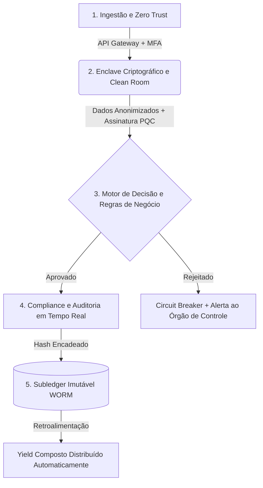

# LOWDATAESC v2.0 
### Infraestrutura de Custódia Neutra, Split Fiscal Auditável e Yield sobre Ativos Ociosos


**Repositório Oficial:** [github.com/kauecodify/LOWDATAESC/tree/main/lowdataesc-v2](https://github.com/kauecodify/LOWDATAESC/tree/main/lowdataesc-v2)  
**Classificação:** Restrito / Documentação Principal de Arquitetura  
**Última Atualização:** 12/11/2026

---

## 1. Visão Geral Executiva

A LOWDATAESC v2 é uma plataforma de confiança institucional de nível soberano, projetada para resolver a paralisia decisória em operações de alta complexidade. Ela transforma a complexidade da Reforma Tributária (CBS/IBS, CBA) e os rigores da Governança de Dados (LGPD) em ativos financeiros produtivos, juridicamente blindados e auditáveis em tempo real.

Diferente de ERPs tradicionais ou blockchains públicas, a v2 opera sob uma Arquitetura Híbrida Soberana, combinando a escalabilidade da nuvem com a segurança absoluta de ambientes on-premise (Serpro/Dataprev), protegida por Criptografia Pós-Quântica (PQC) e Motores de Decisão Determinísticos.

---

## 2. Camadas de Processamento (Arquitetura de Fluxo de Dados)

O processamento de qualquer ativo (seja um split fiscal, um crédito de CBA ou um lote de dados anonimizados) segue um fluxo rígido e imutável através de 5 camadas de processamento. Nenhuma camada pode ser contornada.



### Camada 1: Ingestão e Identidade (`/frontend` e API Gateway)
- **Função:** Ponto de entrada da requisição. Validação rigorosa de identidade e dispositivo.
- **Processamento:** Autenticação multifator (MFA), verificação de certificado digital (e-CPF/e-CNPJ) e análise de fingerprint do dispositivo. Requisições sem credenciais válidas são descartadas no nível de rede.

### Camada 2: Enclave Criptográfico e Data Clean Room (`/backend/crypto`)
- **Função:** Isolamento e proteção dos dados em uso (Data in Use).
- **Processamento:** Os dados brutos entram em um enclave de computação confidencial (ex: AWS Nitro Enclaves ou Intel SGX). Aqui, a pseudonimização e anonimização ocorrem antes de qualquer lógica de negócio. As chaves criptográficas nunca saem do Hardware Security Module (HSM) FIPS 140-2 Nível 3.

### Camada 3: Motor de Decisão e Regras de Negócio (`/backend/engine`)
- **Função:** Execução determinística das regras de negócio específicas de cada órgão.
- **Processamento:** Validação de invariantes (ex: `CBS + IBS == Total`). Se a condição for atendida, a transação prossegue. Se falhar, o sistema aciona o Circuit Breaker, congela a operação e gera um alerta de anomalia, impedindo a propagação de erros ou fraudes.

### Camada 4: Compliance e Auditoria em Tempo Real (`/backend/compliance`)
- **Função:** Validação contínua contra regras regulatórias (LGPD, BCB, TCU, CGU).
- **Processamento:** O motor de compliance intercepta o fluxo aprovado, verifica a base legal do consentimento (hash de consentimento), valida limites orçamentários e aplica o gatekeeping automático contra nós B2C inconformes.

### Camada 5: Subledger Imutável e Yield (`/backend/engine/yield`)
- **Função:** Registro definitivo e geração de valor.
- **Processamento:** A transação aprovada e auditada recebe um hash criptográfico (PQC Dilithium) encadeado ao hash anterior, garantindo imutabilidade (WORM). Simultaneamente, o valor é alocado no pool de custódia, iniciando a retroalimentação de juros compostos e a distribuição automática de revenue share conforme as regras parametrizadas.

---

## 3. Estrutura do Repositório

```text
/lowdataesc-v2/
│
├── /backend/                          
│   ├── /engine/                       # Motor de Regras (Split CBS/IBS, CBA, Yield)
│   ├── /compliance/                   # Motor de Auditoria (LGPD/BCB/TCU em tempo real)
│   ├── /crypto/                       # Módulo de Criptografia Pós-Quântica e HSM
│   └── README.md                      # Documentação técnica detalhada do backend
│
├── /frontend/                         
│   └── index.html                     # Interface "High-Trust Institutional" (Swiss Design)
│
└── /whitelabel/                       # Módulos Específicos por Órgão de Controle
    ├── /TCU/                          # Tribunal de Contas da União (README + DECISION_ENGINE)
    ├── /PGE-SP/                       # Procuradoria Geral do Estado de São Paulo
    ├── /CGU/                          # Controladoria-Geral da União
    ├── /ANPD/                         # Autoridade Nacional de Proteção de Dados
    └── /COMITE-GESTOR-IBS/            # Comitê Gestor do IBS
```

---

## 4. Segurança e Compliance

### Criptografia Pós-Quântica (PQC)
- **Algoritmos:** CRYSTALS-Kyber-768 (Troca de chaves) e CRYSTALS-Dilithium3 (Assinaturas digitais), conforme padrões NIST.
- **Aplicação:** Túneis TLS 1.3 Híbridos (RSA-4096 + Kyber) e assinatura de todos os logs de auditoria para garantir longevidade da prova jurídica contra a ameaça "Harvest Now, Decrypt Later".

### Imutabilidade (WORM)
- **Subledger:** Todos os registros de transação e alteração de regras são gravados em armazenamento Write Once, Read Many.
- **Hashing Encadeado:** Cada bloco de dados contém o hash do bloco anterior, criando uma cadeia de custódia inquebrável.

### Hardware de Segurança
- **HSM (Hardware Security Module):** Certificação FIPS 140-2 Nível 3. As chaves mestras são geradas e utilizadas exclusivamente dentro do hardware, nunca expostas na memória RAM do servidor.
- **QRNG (Quantum Random Number Generator):** Utilizado para garantir entropia verdadeira e imprevisibilidade na geração de chaves de sessão.

---

## 5. Infraestrutura Híbrida Soberana

Para mitigar riscos de soberania de dados e garantir conformidade com a LGPD, a arquitetura é dividida em:

1. **Nuvem Local (On-Premise):** Data centers de estatais (Serpro/Dataprev). Hospeda o core da plataforma, o banco de dados imutável e os HSMs. Garante que os dados brutos e sensíveis nunca deixem o território nacional.
2. **Nuvem Pública (Camada de Apresentação):** Provedores como AWS GovCloud ou Azure Government. Hospeda apenas o frontend (`index.html`) e APIs de baixo risco, garantindo alta disponibilidade e baixa latência.
3. **Conexão Segura:** Comunicação entre as camadas realizada exclusivamente via links dedicados (MPLS) ou fibra óptica privada, com criptografia de ponta a ponta, sem trânsito pela internet pública.

---

## 6. Como Começar (Ambiente de Desenvolvimento)

### Pré-requisitos
- Node.js 18+ e Python 3.10+
- Docker e Kubernetes (para orquestração dos serviços)
- PostgreSQL 15+ (para metadados operacionais)
- Acesso a simulador de HSM ou ambiente de enclave para testes de criptografia

### Instalação e Execução
```bash
# Clonar o repositório
git clone https://github.com/kauecodify/LOWDATAESC.git
cd LOWDATAESC/lowdataesc-v2

# Instalar dependências do backend
cd backend
npm install

# Iniciar serviços via Docker Compose (Ambiente de Sandbox)
docker-compose up -d

# Iniciar frontend (servidor de desenvolvimento)
cd ../frontend
npx serve
```

### Acessos Locais (Sandbox)
- **Frontend:** `http://localhost:3000`
- **API Backend:** `http://localhost:8080`
- **Painéis Whitelabel:** Acessíveis via rotas específicas (ex: `/tcu`, `/pge-sp`), conforme documentado na pasta `/whitelabel`.

---

## 7. Contatos e Suporte

| Função | Canal de Contato |
| :--- | :--- |
| **Suporte Técnico** | suporte@lowdataesc.gov.br |
| **Arquitetura e Infraestrutura** | arquitetura@lowdataesc.gov.br |
| **Segurança da Informação (SOC)** | soc@lowdataesc.gov.br |
| **Compliance e Jurídico** | compliance@lowdataesc.gov.br |

---

## 8. Aviso Legal e Confidencialidade

Este documento e o código associado são classificados como **Confidenciais** e destinam-se exclusivamente ao uso interno da LOWDATAESC e de parceiros autorizados (TCU, PGE-SP, CGU, ANPD, Comitê Gestor do IBS). 

A divulgação, reprodução ou distribuição não autorizada pode resultar em sanções administrativas e penais, em conformidade com:
- Lei de Acesso à Informação (LAI - Lei 12.527/2011)
- Lei de Segurança da Informação (LSI - Lei 13.808/2019)
- Lei de Improbidade Administrativa (Lei 8.429/1992)
- Lei Geral de Proteção de Dados (LGPD - Lei 13.709/2018)

---

**LOWDATAESC v2.0**  
Infraestrutura de Confiança para o Setor Público e Financeiro.  
Desenvolvido em colaboração com órgãos de controle e padrões NIST.  

*laboratory of k by rocknewventure*
