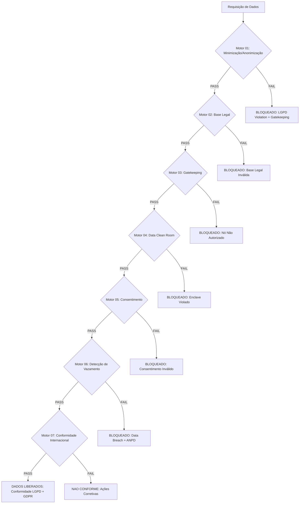

# **MOTORES DE DECISÃO - ANPD (Autoridade Nacional de Proteção de Dados)**
**Versão:** 2.0 | **Classificação:** Restrito / Automação de Governança de Dados
**Responsável:** Gabinete da Autoridade Nacional de Proteção de Dados
**Última Atualização:** 2024-11-15

---

## **📌 Visão Geral**

O **ANPD** utiliza **7 Motores de Decisão Automatizados** para **garantir a conformidade com a LGPD (Lei 13.709/2018)** e as melhores práticas de privacidade. Cada motor é **imutável**, **auditável** e **assinado digitalmente** com **Criptografia Pós-Quântica (PQC - Dilithium)**.

Os motores operam em **cascata**, validando desde o **consentimento** até a **anonimização final** dos dados. **Qualquer falha** resulta em **bloqueio imediato** e **notificação à ANPD**.

---

## **🔧 Motor de Decisão 01: Minimização e Anonimização de Dados (LGPD - Art. 6º, II)**
**ID:** `ANPD-DE-001` | **Prioridade:** Crítica | **Frequência:** Tempo Real

### **🎯 Gatilho**
- **Requisição de API** de terceiros para consumo de dados.
- **Processamento de dados** dentro do Data Clean Room.
- Eventos: `API_REQUEST`, `DATA_PROCESSING`, `BATCH_EXPORT`

### **✅ Regras de Validação (AND Lógico)**

| **Regra**               | **Descrição**                                                                                     | **Fórmula**                                                                                     | **Tolerância** | **Código de Erro**          |
|-------------------------|-------------------------------------------------------------------------------------------------|------------------------------------------------------------------------------------------------|----------------|-----------------------------|
| `Consent_Hash_Check`    | Deve existir um **registro imutável de consentimento** (ou base legal) vinculado ao `data_batch_id`. | `ConsentRegistry.Contains(DataBatchID) == TRUE`                                                | -              | `CONSENTIMENTO_AUSENTE`      |
| `Pseudonymization_Check`| **Todos os campos diretos** (CPF, Nome, RG, CNPJ) devem ser **substituídos por tokens irreversíveis** ANTES de sair do enclave. | `SensitiveFields.All(ReplacedByToken) == TRUE`                                                  | -              | `DADOS_NAO_PSEUDONIMIZADOS` |
| `Purpose_Limitation`    | A **finalidade da requisição** deve corresponder **exatamente** à finalidade registrada no consentimento. | `Request.Purpose == Consent.Purpose`                                                             | -              | `FINALIDADE_NAO_COMPATIVEL` |
| `Data_Minimization`     | Apenas os **dados estritamente necessários** devem ser processados (LGPD - Art. 6º, III).    | `ProcessedData.Fields == RequiredFields`                                                        | -              | `DADOS_EXCESSIVOS`          |

### **🔄 Ações do Motor**

#### **✅ SE PASS (Todas as regras válidas)**
1. **Dados anonimizados/pseudonimizados liberados** para a API solicitante.
2. **Certificado de processamento gerado:**
   ```json
   {
     "data_batch_id": "{UUID_v4}",
     "consent_hash": "SHA256(Consent)",
     "anonymization_method": "Tokenization" | "K-Anonymity" | "Differential Privacy",
     "destination_node_hash": "SHA256(Destination_Node_Certificate)",
     "timestamp": "{ISO_8601}",
     "assinatura_PQC": "Dilithium_Signature(Hash, HSM_PrivateKey)"
   }
   ```
3. **Contador de "Requisições Conformidade OK" incrementado**.

#### **❌ SE FAIL (Qualquer regra falha)**
1. **Requisição bloqueada** no gateway.
2. **Evento `LGPD_VIOLATION_ATTEMPT` registrado:**
   ```json
   {
     "event_type": "LGPD_VIOLATION_ATTEMPT",
     "data_batch_id": "{UUID_v4}",
     "failed_rule": "{Rule_Name}",
     "error_code": "{Error_Code}",
     "timestamp": "{ISO_8601}",
     "requester_node_hash": "{Node_Hash}",
     "details": "{Error_Details}"
   }
   ```
3. **Nó requisitante adicionado à lista de bloqueio (Gatekeeping)**.
4. **Notificação** enviada à **ANPD** e ao **requisitante**.

### **📄 Saída Auditável**
- **Formato:** JSON + Assinatura PQC (Dilithium)
- **Armazenamento:** Ledger Imutável (WORM) + Backup em Fita Magnética
- **Retenção:** 5 anos (padrão LGPD)
- **Exportação:** PDF (assinado), JSON (API), XML (Padrão ANPD)

---

## **🔧 Motor de Decisão 02: Validação de Base Legal (LGPD - Art. 7º e 11º)**
**ID:** `ANPD-DE-002` | **Prioridade:** Crítica | **Frequência:** Tempo Real

### **🎯 Gatilho**
- **Processamento de dados** sem base legal registrada.
- **Alteração na finalidade** do processamento.

### **✅ Regras de Validação**

| **Regra**               | **Descrição**                                                                                     | **Fórmula**                                                                                     | **Código de Erro**          |
|-------------------------|-------------------------------------------------------------------------------------------------|------------------------------------------------------------------------------------------------|-----------------------------|
| `Legal_Basis_Existence` | Deve existir uma **base legal** (consentimento, legítimo interesse, etc.) para o processamento. | `DataBatch.LegalBasis != NULL`                                                                   | `BASE_LEGAL_AUSENTE`        |
| `Legal_Basis_Validity`  | A base legal deve ser **válida** (ex: consentimento não retirado, legítimo interesse justificado). | `LegalBasis.Status == "ACTIVE" && LegalBasis.ExpiryDate > CurrentDate`                          | `BASE_LEGAL_INVALIDA`       |
| `Legal_Basis_Type`      | A base legal deve ser **compatível** com o tipo de dado (ex: consentimento para dados sensíveis). | `LegalBasis.Type.Includes("CONSENT", "LEGITIMATE_INTEREST", "LEGAL_OBLIGATION")`               | `BASE_LEGAL_INCOMPATIVEL`   |
| `Sensitive_Data_Check`   | Dados **sensíveis** (saúde, origem étnica, etc.) exigem **consentimento explícito** (LGPD - Art. 11, §1º). | `Data.Type == "SENSITIVE" && LegalBasis.Type == "EXPLICIT_CONSENT"`                           | `CONSENTIMENTO_IMPLICITO`   |

### **🔄 Ações do Motor**

#### **✅ SE PASS**
1. **Processamento liberado** (se outras regras também passarem).

#### **❌ SE FAIL**
1. **Processamento bloqueado**.
2. **Solicitação de regularização** enviada ao **controlador de dados**.

### **📄 Saída Auditável**
```json
{
  "data_batch_id": "{UUID_v4}",
  "legal_basis": {
    "type": "CONSENT" | "LEGITIMATE_INTEREST" | "LEGAL_OBLIGATION",
    "status": "ACTIVE" | "EXPIRED" | "REVOKED",
    "expiry_date": "{YYYY-MM-DD}"
  },
  "validation_status": "APROVADO" | "REJEITADO",
  "timestamp": "{ISO_8601}",
  "assinatura_PQC": "{Dilithium_Signature}"
}
```

---

## **🔧 Motor de Decisão 03: Gatekeeping Automático (Defesa contra B2C Inconformes)**
**ID:** `ANPD-DE-003` | **Prioridade:** Crítica | **Frequência:** Tempo Real

### **🎯 Gatilho**
- **Nova conexão** de um nó externo (B2C, B2G).
- **Tentativa de acesso** a dados sem autorização.

### **✅ Regras de Validação**

| **Regra**               | **Descrição**                                                                                     | **Fórmula**                                                                                     | **Código de Erro**          |
|-------------------------|-------------------------------------------------------------------------------------------------|------------------------------------------------------------------------------------------------|-----------------------------|
| `Compliance_Certificate`| O nó deve possuir um **certificado de compliance LGPD** válido (emitido pela ANPD).           | `Node.ComplianceCertificate.Status == "ACTIVE" && Node.ComplianceCertificate.Issuer == "ANPD"` | `CERTIFICADO_LGPD_AUSENTE`  |
| `Blacklist_Check`       | O nó **não pode estar na lista negra** da ANPD (por violações anteriores).                     | `Blacklist.Contains(Node.ID) == FALSE`                                                           | `NO_BLOQUEADO_ANPD`          |
| `Data_Access_Right`     | O nó deve ter **direito de acesso** aos dados solicitados.                                     | `Node.AccessRights.Includes(RequestedDataType) == TRUE`                                        | `ACESSO_NAO_AUTORIZADO`     |
| `PQC_Capability`         | O nó deve suportar **Criptografia Pós-Quântica (PQC)** para comunicação.                        | `Node.Capabilities.Includes("PQC_Dilithium") == TRUE`                                         | `NODE_SEM_PQC`              |

### **🔄 Ações do Motor**

#### **✅ SE PASS**
1. **Conexão liberada**.
2. **Log de acesso** gravado.

#### **❌ SE FAIL**
1. **Conexão bloqueada no nível TCP/IP** (firewall - WAF).
2. **Nó adicionado à lista negra (Gatekeeping)**.
3. **Notificação** enviada à **ANPD** e ao **nó bloqueado**.

### **📄 Saída Auditável**
```json
{
  "node_id": "{UUID_v4}",
  "node_type": "B2C" | "B2G",
  "access_status": "APROVADO" | "BLOQUEADO",
  "block_reason": "CERTIFICADO_AUSENTE" | "LISTA_NEGRA" | "ACESSO_NAO_AUTORIZADO" | "SEM_PQC",
  "timestamp": "{ISO_8601}",
  "assinatura_PQC": "{Dilithium_Signature}"
}
```

---

## **🔧 Motor de Decisão 04: Auditoria de Processamento no Data Clean Room**
**ID:** `ANPD-DE-004` | **Prioridade:** Alta | **Frequência:** Tempo Real

### **🎯 Gatilho**
- **Início de processamento** no Data Clean Room.
- **Fim de processamento** (para verificação de conformidade).

### **✅ Regras de Validação**

| **Regra**               | **Descrição**                                                                                     | **Fórmula**                                                                                     | **Código de Erro**          |
|-------------------------|-------------------------------------------------------------------------------------------------|------------------------------------------------------------------------------------------------|-----------------------------|
| `Enclave_Integrity`     | O processamento deve ocorrer **dentro do enclave de computação confidencial**.                  | `ProcessingEnvironment == "Enclave"`                                                           | `AMBIENTE_NAO_SEGURO`       |
| `Data_Immutability`     | Os dados **não podem ser alterados** durante o processamento.                                   | `InputData.Hash == OutputData.InputHash`                                                        | `DADOS_ALTERADOS`           |
| `No_Raw_Data_Leak`      | **Nenhum dado bruto** pode vaziar do enclave.                                                     | `Enclave.Logs.Contains("RAW_DATA_EXPORT") == FALSE`                                            | `VAZAMENTO_DADOS_BRUTOS`    |
| `Processing_Log`        | Todas as operações no enclave devem ser **registradas**.                                        | `Enclave.Logs.Count > 0`                                                                         | `LOG_PROCESSAMENTO_FALTANTE`|

### **🔄 Ações do Motor**

#### **✅ SE PASS**
1. **Processamento aprovado**.
2. **Certificado de conformidade** gerado.

#### **❌ SE FAIL**
1. **Processamento interrompido**.
2. **Alerta de "Violação de Enclave"** enviado à **ANPD** e ao **SOC**.

### **📄 Saída Auditável**
```json
{
  "processing_id": "{UUID_v4}",
  "enclave_status": "INTEGRO" | "VIOLADO",
  "data_immutability": "GARANTIDA" | "COMPROMETIDA",
  "raw_data_leak": false | true,
  "timestamp": "{ISO_8601}",
  "assinatura_PQC": "{Dilithium_Signature}"
}
```

---

## **🔧 Motor de Decisão 05: Validação de Consentimento (LGPD - Art. 8º)**
**ID:** `ANPD-DE-005` | **Prioridade:** Crítica | **Frequência:** Event-Driven

### **🎯 Gatilho**
- **Novo consentimento** registrado.
- **Retirada de consentimento** (LGPD - Art. 8º, §5º).
- **Alteração na finalidade** do consentimento.

### **✅ Regras de Validação**

| **Regra**               | **Descrição**                                                                                     | **Fórmula**                                                                                     | **Código de Erro**          |
|-------------------------|-------------------------------------------------------------------------------------------------|------------------------------------------------------------------------------------------------|-----------------------------|
| `Consent_Clarity`       | O consentimento deve ser **claro, específico e informado** (LGPD - Art. 8º, §1º).              | `Consent.Text.Length >= 50 && Consent.SpecificPurposes.Count > 0`                               | `CONSENTIMENTO_VAGO`        |
| `Consent_Free`          | O consentimento deve ser **livre** (sem coação).                                                 | `Consent.GivenFreely == TRUE`                                                                   | `CONSENTIMENTO_COAGIDO`     |
| `Consent_Revokable`     | O consentimento deve poder ser **retirado a qualquer momento**.                                  | `Consent.AllowRevocation == TRUE`                                                               | `CONSENTIMENTO_IRREVOGAVEL` |
| `Consent_Record_Immutable` | O registro de consentimento deve ser **imutável**.                                           | `ConsentRegistry.Immutable == TRUE`                                                            | `REGISTRO_CONSENTIMENTO_MUTAVEL` |

### **🔄 Ações do Motor**

#### **✅ SE PASS**
1. **Consentimento válido** e registrado no **Ledger Imutável**.

#### **❌ SE FAIL**
1. **Consentimento rejeitado**.
2. **Notificação** enviada ao **controlador de dados** para correção.

### **📄 Saída Auditável**
```json
{
  "consent_id": "{UUID_v4}",
  "consent_status": "APROVADO" | "REJEITADO",
  "consent_hash": "SHA256(Consent)",
  "timestamp": "{ISO_8601}",
  "assinatura_PQC": "{Dilithium_Signature}"
}
```

---

## **🔧 Motor de Decisão 06: Detecção de Vazamento de Dados (Data Breach)**
**ID:** `ANPD-DE-006` | **Prioridade:** Crítica | **Frequência:** Tempo Real

### **🎯 Gatilho**
- **Acesso não autorizado** a dados pessoais.
- **Exportação suspeita** de dados.
- **Alteração indevida** em dados sensíveis.

### **✅ Regras de Validação**

| **Regra**               | **Descrição**                                                                                     | **Fórmula**                                                                                     | **Código de Erro**          |
|-------------------------|-------------------------------------------------------------------------------------------------|------------------------------------------------------------------------------------------------|-----------------------------|
| `Unauthorized_Access`   | Detecta **acessos não autorizados** a dados pessoais.                                           | `AccessLog.User.Permission.Includes("ACCESS_PERSONAL_DATA") == FALSE`                         | `ACESSO_NAO_AUTORIZADO`     |
| `Massive_Data_Export`   | Detecta **exportações massivas** de dados (ex: > 10.000 registros em 1 hora).                   | `Export.Count > 10000 && Export.TimeWindow <= 1h`                                               | `EXPORTACAO_MASSIVA`        |
| `Sensitive_Data_Change` | Detecta **alterações não autorizadas** em dados sensíveis.                                    | `ChangeLog.Data.Type == "SENSITIVE" && ChangeLog.Authorization == "DENIED"`                    | `ALTERACAO_DADOS_SENSIVEIS` |
| `Encryption_Bypass`     | Detecta **tentativas de contornar a criptografia**.                                            | `AccessLog.EncryptionStatus == "BYPASS"`                                                       | `CRIPTOGRAFIA_CONTORNADA`   |

### **🔄 Ações do Motor**

#### **✅ SE PASS**
1. **Acesso liberado** (mas monitorado).

#### **❌ SE FAIL**
1. **Acesso bloqueado imediatamente**.
2. **Alerta de "Violação de Dados"** (`DATA_BREACH`) gerado:
   ```json
   {
     "event_type": "DATA_BREACH",
     "severity": "HIGH" | "CRITICAL",
     "affected_data": [{"data_type": "{Type}", "count": {Count}}],
     "timestamp": "{ISO_8601}",
     "assinatura_PQC": "{Dilithium_Signature}",
     "notified_entities": ["ANPD", "SOC", "MPF"]
   }
   ```
3. **Notificação à ANPD e aos titulares dos dados** (em até 72 horas, conforme LGPD - Art. 48).
4. **Investigação forense** iniciada automaticamente.

---

## **🔧 Motor de Decisão 07: Conformidade com Normas Internacionais (GDPR, ISO 27701)**
**ID:** `ANPD-DE-007` | **Prioridade:** Alta | **Frequência:** Mensal

### **🎯 Gatilho**
- **Fim do mês fiscal** (últimos 2 dias do mês).
- **Solicitação manual** de auditoria de conformidade internacional.

### **✅ Regras de Validação**

| **Regra**               | **Descrição**                                                                                     | **Fórmula**                                                                                     | **Código de Erro**          |
|-------------------------|-------------------------------------------------------------------------------------------------|------------------------------------------------------------------------------------------------|-----------------------------|
| `GDPR_Compliance`       | O processamento deve estar em **conformidade com o GDPR** (para dados de cidadãos europeus).  | `GDPR.Checklist.All(Compliant) == TRUE`                                                          | `NAO_CONFORME_GDPR`         |
| `ISO_27701_Compliance`  | O sistema deve seguir as **diretrizes da ISO 27701** (extensão da ISO 27001 para privacidade). | `ISO27701.Checklist.All(Compliant) == TRUE`                                                      | `NAO_CONFORME_ISO_27701`    |
| `Cross_Border_Transfer` | Transferências internacionais de dados devem **respeitar os acordos de adequação** (ex: Brasil-UE). | `Transfer.Destination.Country.Includes("ADEQUATE") == TRUE`                                    | `TRANSFERENCIA_INSEGURA`    |
| `Data_Retention`        | Dados não devem ser **retenuidos por mais tempo do que o necessário**.                         | `Data.RetentionPeriod <= LegalRetentionPeriod`                                                 | `RETENCAO_EXCESSIVA`        |

### **🔄 Ações do Motor**

#### **✅ SE PASS**
1. **Certificado de conformidade internacional** gerado.
2. **Relatório de auditoria** enviado à **ANPD**.

#### **❌ SE FAIL**
1. **Ações corretivas** solicitadas.
2. **Notificação** enviada à **ANPD** e aos **controladores de dados**.

### **📄 Saída Auditável**
```json
{
  "audit_id": "{UUID_v4}",
  "compliance_status": {
    "gdpr": "CONFORME" | "NAO_CONFORME",
    "iso_27701": "CONFORME" | "NAO_CONFORME",
    "cross_border": "CONFORME" | "NAO_CONFORME"
  },
  "non_compliances": [{"rule": "{Rule_Name}", "details": "{Details}"}],
  "timestamp": "{ISO_8601}",
  "assinatura_PQC": "{Dilithium_Signature}"
}
```

---

## **📊 Fluxograma de Execução dos Motores**



---

## **🔐 Segurança e Assinaturas**

- **Todos os logs** são assinados com **CRYSTALS-Dilithium (PQC)**.
- **Todos os hashes** são encadeados no **Ledger Imutável (WORM)**.
- **Todos os acessos** ao Data Clean Room são registrados com **MFA + Biometria + Certificado ICP-Brasil A3**.
- **Todas as transferências de dados** são criptografadas com **TLS 1.3 + PQC (Kyber + Dilithium)**.

---

## **📞 Contatos para Suporte**

| **Tipo**               | **Contato**                          | **Email**                          | **Telefone**       |
|------------------------|--------------------------------------|------------------------------------|--------------------|
| **Suporte Técnico**    | Equipe LOWDATAESC                    | suporte@lowdataesc.gov.br          | +55 (61) 9999-9999 |
| **Governança de Dados**| ANPD - Autoridade Nacional de Proteção de Dados | ouvidoria@anpd.gov.br | +55 (61) 3316-4000 |
| **Emergências**        | SOC (Security Operations Center)     | soc@lowdataesc.gov.br              | +55 (61) 9999-0000 |
| **Denúncias**          | ANPD (Canal de Denúncias)            | denuncia@anpd.gov.br               | 0800-728-2020      |

---

**⚠️ Aviso:**
Este documento é **restrito** e destina-se **exclusivamente** ao uso interno da **ANPD** e parceiros autorizados. A divulgação não autorizada é **proibida por lei** (LGPD - Art. 52).

---

**🏛️ LOWDATAESC v2.0 | ANPD - Autoridade Nacional de Proteção de Dados**
*Desenvolvido em colaboração com a ANPD, Serpro, Dataprev e NIST PQC Standards.*
