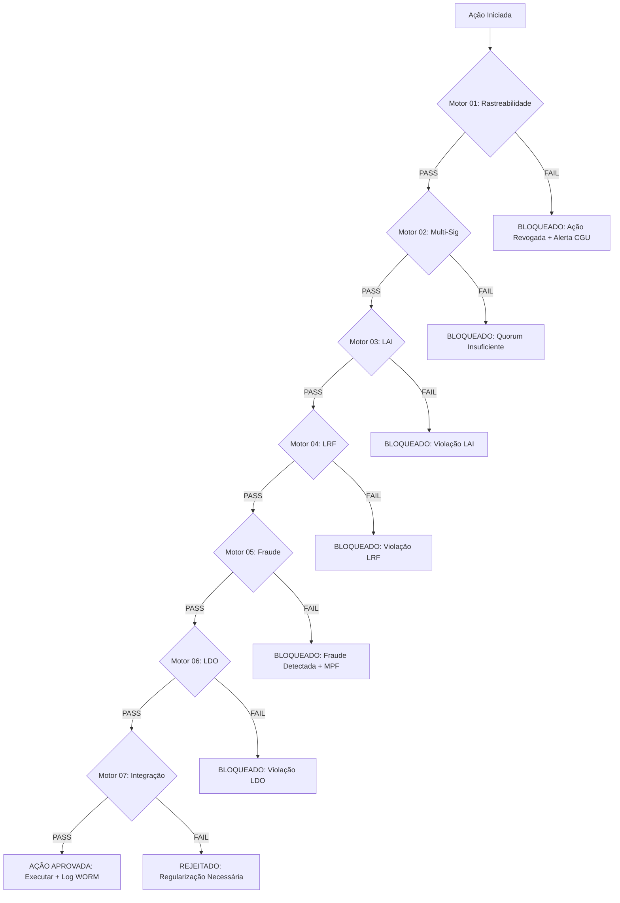

# **MOTORES DE DECISÃO - CGU (Controladoria-Geral da União)**
**Versão:** 2.0 | **Classificação:** Restrito / Automação de Integridade Pública
**Responsável:** Secretaria de Transparência e Prevenção da Corrupção
**Última Atualização:** 2024-11-15

---

## **📌 Visão Geral**

O **CGU** utiliza **7 Motores de Decisão Automatizados** para **rastrear, validar e auditar** todas as ações dentro da LOWDATAESC v2, garantindo **transparência, integridade e compliance** com as leis brasileiras (LAI, LRF, LDO, Lei de Improbidade).

Cada motor é **imutável**, **auditável** e **assinado digitalmente** com **Criptografia Pós-Quântica (PQC - Dilithium)**. Os motores operam em **cascata**, e **qualquer rejeição** resulta em **bloqueio imediato** e **notificação às autoridades competentes**.

---

## **🔧 Motor de Decisão 01: Rastreabilidade de Decisão (Who, What, When, Where, Why)**
**ID:** `CGU-DE-001` | **Prioridade:** Crítica | **Frequência:** Tempo Real

### **🎯 Gatilho**
- **Qualquer alteração** nas regras de negócio, parâmetros de split (CBS/IBS) ou autorização de saque do escrow.
- **Acesso a dados sensíveis** (ex: subledger de ativos, logs de auditoria).
- Eventos: `RULE_CHANGE`, `PARAMETER_UPDATE`, `ESCROW_WITHDRAWAL`, `SENSITIVE_DATA_ACCESS`

### **✅ Regras de Validação (AND Lógico)**

| **Regra**               | **Descrição**                                                                                     | **Fórmula**                                                                                     | **Tolerância** | **Código de Erro**          |
|-------------------------|-------------------------------------------------------------------------------------------------|------------------------------------------------------------------------------------------------|----------------|-----------------------------|
| `Identity_Check`        | O solicitante deve possuir **MFA ativo** (Biometria + Hardware Token).                        | `User.MFA.Status == "ACTIVE" && User.MFA.Methods.Includes("Biometria", "HardwareToken")`      | -              | `MFA_INATIVO`               |
| `Permission_Check`      | O solicitante deve ter **nível de permissão** compatível com a ação (`APPROVER_L3` para alterações críticas). | `User.Permissions.Includes("APPROVER_L3") == TRUE`                                              | -              | `PERMISSAO_INSUFICIENTE`    |
| `IP_Whitelisting`        | O IP de origem deve estar na **lista branca da CGU**.                                           | `IPWhitelist.Contains(User.IP) == TRUE`                                                         | -              | `IP_NAO_AUTORIZADO`         |
| `Device_Fingerprint`    | O dispositivo deve ser **reconhecido** (fingerprint cadastrado).                              | `DeviceRegistry.Contains(User.DeviceFingerprint) == TRUE`                                       | -              | `DISPOSITIVO_DESCONHECIDO`   |
| `Justification_Required`| A ação deve ter uma **justificativa** (campo obrigatório).                                       | `Action.Justification != NULL && Action.Justification.Length >= 20`                              | -              | `JUSTIFICATIVA_AUSENTE`     |

### **🔄 Ações do Motor**

#### **✅ SE PASS (Todas as regras válidas)**
1. **Ação executada** (ex: regra alterada, saque autorizado).
2. **Log de "Rastreabilidade de Decisão" gerado** com:
   ```json
   {
     "action_id": "{UUID_v4}",
     "action_type": "RULE_CHANGE" | "PARAMETER_UPDATE" | "ESCROW_WITHDRAWAL",
     "user_id_hash": "SHA256(User.CPF)",
     "user_permission": "APPROVER_L3",
     "timestamp": "{ISO_8601}",
     "ip": "{User.IP}",
     "device_fingerprint": "{Device.Hash}",
     "justification": "{Action.Justification}",
     "hash_anterior": "{Previous_Hash}",
     "hash_atual": "SHA256(Action_Data + Previous_Hash)",
     "assinatura_PQC": "Dilithium_Signature(Hash_Atual, HSM_PrivateKey)"
   }
   ```
3. **Log gravado** no **Ledger Imutável (WORM)**.
4. **Evento** `ACTION_APPROVED` enviado ao **Painel de Integridade da CGU**.

#### **❌ SE FAIL (Qualquer regra falha)**
1. **Ação revogada imediatamente** (rollback automático).
2. **Alerta de "Tentativa de Alteração Não Autorizada"** gerado:
   ```json
   {
     "event_type": "ALTERACAO_NAO_AUTORIZADA",
     "action_type": "{Action_Type}",
     "user_id_hash": "SHA256(User.CPF)",
     "failed_rule": "{Rule_Name}",
     "error_code": "{Error_Code}",
     "timestamp": "{ISO_8601}",
     "ip": "{User.IP}",
     "device_fingerprint": "{Device.Hash}"
   }
   ```
3. **Notificação push + email** enviada ao **Painel de Integridade Pública da CGU**.
4. **Usuário bloqueado temporariamente** (1 hora) para investigação.

### **📄 Saída Auditável**
- **Formato:** JSON + Assinatura PQC (Dilithium)
- **Armazenamento:** Ledger Imutável (WORM) + Backup em Fita Magnética (Air-Gapped)
- **Retenção:** 30 anos (padrão CGU)
- **Exportação:** PDF (assinado), JSON (API), XML (Padrão CGU)

---

## **🔧 Motor de Decisão 02: Multi-Sig (Assinatura Múltipla para Ações Críticas)**
**ID:** `CGU-DE-002` | **Prioridade:** Crítica | **Frequência:** Sob Demanda

### **🎯 Gatilho**
- **Alterações que afetam valores > R$ 1.000.000,00** (ex: split CBS/IBS, saque do escrow).
- **Modificação de regras de compliance** (ex: parâmetros de LGPD, PQC).

### **✅ Regras de Validação**

| **Regra**               | **Descrição**                                                                                     | **Fórmula**                                                                                     | **Código de Erro**          |
|-------------------------|-------------------------------------------------------------------------------------------------|------------------------------------------------------------------------------------------------|-----------------------------|
| `Quorum_Check`          | Se a alteração afeta **> R$ 1MM**, exige **assinatura múltipla (Multi-Sig)** de pelo menos **2 gestores de áreas distintas**. | `Approvers.Count >= 2 && Approvers.Areas.Distinct() == TRUE`                                    | `QUORUM_INSUFICIENTE`       |
| `Approver_Permission`   | Cada aprovador deve ter **nível `APPROVER_L3` ou superior**.                                   | `Approvers.All(Permission >= "APPROVER_L3") == TRUE`                                            | `APROVADOR_NAO_AUTORIZADO`  |
| `Signatures_Validity`    | Todas as assinaturas devem ser **válidas** (PQC - Dilithium).                                  | `Approvers.All(Signature.Verify(PQC_Dilithium) == TRUE)`                                       | `ASSINATURA_INVALIDA`       |
| `Time_Window`           | Todas as assinaturas devem ser **coletadas dentro de 24 horas**.                              | `(LastSignature.Timestamp - FirstSignature.Timestamp) <= 24h`                                  | `JANELA_TEMPORAL_EXPIRADA`  |

### **🔄 Ações do Motor**

#### **✅ SE PASS**
1. **Ação executada** (ex: regra alterada, saque liberado).
2. **Log de Multi-Sig gravado**:
   ```json
   {
     "action_id": "{UUID_v4}",
     "multi_sig_status": "APROVADO",
     "approvers": [
       {
         "user_id_hash": "SHA256(User1.CPF)",
         "permission": "APPROVER_L3",
         "signature": "{PQC_Signature}",
         "timestamp": "{ISO_8601}"
       },
       {
         "user_id_hash": "SHA256(User2.CPF)",
         "permission": "APPROVER_L3",
         "signature": "{PQC_Signature}",
         "timestamp": "{ISO_8601}"
       }
     ],
     "assinatura_PQC": "Dilithium_Signature(Hash, HSM_PrivateKey)"
   }
   ```

#### **❌ SE FAIL**
1. **Ação bloqueada** até que o **quorum seja atingido**.
2. **Notificação** enviada aos **aprovadores pendentes**.
3. **Alerta** gerado no **Painel de Integridade**.

---

## **🔧 Motor de Decisão 03: Compliance com LAI (Lei de Acesso à Informação)**
**ID:** `CGU-DE-003` | **Prioridade:** Alta | **Frequência:** Tempo Real

### **🎯 Gatilho**
- **Solicitação de acesso a dados públicos** (ex: relatórios de transações, logs de auditoria).
- **Tentativa de ocultar informações** que deveriam ser públicas.

### **✅ Regras de Validação**

| **Regra**               | **Descrição**                                                                                     | **Fórmula**                                                                                     | **Código de Erro**          |
|-------------------------|-------------------------------------------------------------------------------------------------|------------------------------------------------------------------------------------------------|-----------------------------|
| `Public_Data_Check`     | Dados **públicos** (ex: transações CBS/IBS) não podem ser **ocultados**.                        | `Data.Classification != "RESTRICTED" || Action == "ALLOW_ACCESS"`                              | `DADO_PUBLICO_OCULTADO`     |
| `Restricted_Data_Protection` | Dados **restritos** (ex: CPF, CNPJ) não podem ser **divulgados sem autorização**.            | `Data.Classification == "RESTRICTED" && User.Permission.Includes("ACCESS_RESTRICTED")`        | `ACESSO_NAO_AUTORIZADO`     |
| `LAI_Deadline`          | Solicitações de dados públicos devem ser **respondidas em até 20 dias** (LAI - Art. 11).      | `(CurrentDate - RequestDate).Days <= 20`                                                        | `PRAZO_LAI_VIOLADO`         |
| `Transparency_Log`      | Todas as solicitações de acesso devem ser **registradas** no ledger de transparência.         | `AccessLog.Contains(RequestID) == TRUE`                                                         | `LOG_TRANSPARENCIA_FALTANTE`|

### **🔄 Ações do Motor**

#### **✅ SE PASS**
1. **Acesso liberado** (para dados públicos) ou **negado com justificativa** (para dados restritos).
2. **Log de acesso** gravado no **Ledger de Transparência**.

#### **❌ SE FAIL**
1. **Acesso bloqueado**.
2. **Notificação** enviada ao **Solicitante** e à **CGU**.
3. **Processo administrativo** aberto (se houver ocultação intencional).

### **📄 Saída Auditável**
```json
{
  "access_id": "{UUID_v4}",
  "data_classification": "PUBLIC" | "RESTRICTED",
  "user_id_hash": "SHA256(User.CPF)",
  "access_status": "APPROVED" | "DENIED",
  "justification": "{Justification}",
  "timestamp": "{ISO_8601}",
  "assinatura_PQC": "{Dilithium_Signature}"
}
```

---

## **🔧 Motor de Decisão 04: Compliance com LRF (Lei de Responsabilidade Fiscal)**
**ID:** `CGU-DE-004` | **Prioridade:** Crítica | **Frequência:** Tempo Real

### **🎯 Gatilho**
- **Qualquer transação** que possa **afetar o orçamento público** (ex: saque do escrow, alocação de yield).

### **✅ Regras de Validação**

| **Regra**               | **Descrição**                                                                                     | **Fórmula**                                                                                     | **Código de Erro**          |
|-------------------------|-------------------------------------------------------------------------------------------------|------------------------------------------------------------------------------------------------|-----------------------------|
| `Budget_Limit_Check`    | O valor da transação não pode **exceder o limite orçamentário** (LRF - Art. 9º).              | `Transaction.Value <= Budget.Limit`                                                             | `LIMITE_ORCAMENTARIO_EXCEDIDO` |
| `Debt_Limit_Check`      | A transação não pode **aumentar a dívida pública** além do limite (LRF - Art. 30).            | `(TotalDebt + Transaction.Value) <= MaxAllowedDebt`                                             | `LIMITE_DIVIDA_EXCEDIDO`    |
| `Fiscal_Responsibility` | A transação deve **respeitar as metas fiscais** (LRF - Art. 4º).                              | `FiscalResult.AfterTransaction >= FiscalTarget`                                                 | `META_FISCAL_VIOLADA`       |
| `Transparency_Report`   | Relatórios fiscais devem ser **publicados trimestralmente** (LRF - Art. 48).                   | `LastReportDate >= (CurrentDate - 90 Days)`                                                     | `RELATORIO_FISCAL_ATRASADO` |

### **🔄 Ações do Motor**

#### **✅ SE PASS**
1. **Transação liberada**.
2. **Log de compliance LRF** gravado.

#### **❌ SE FAIL**
1. **Transação bloqueada**.
2. **Alerta de "Violação LRF"** enviado ao **TCU** e **Ministério da Fazenda**.
3. **Processo administrativo** aberto automaticamente.

### **📄 Saída Auditável**
```json
{
  "transaction_id": "{UUID_v4}",
  "lrr_compliance": {
    "budget_limit": "OK" | "EXCEEDED",
    "debt_limit": "OK" | "EXCEEDED",
    "fiscal_target": "OK" | "VIOLATED"
  },
  "status": "APROVADO" | "BLOQUEADO",
  "timestamp": "{ISO_8601}",
  "assinatura_PQC": "{Dilithium_Signature}"
}
```

---

## **🔧 Motor de Decisão 05: Detecção de Fraudes e Corrupção**
**ID:** `CGU-DE-005` | **Prioridade:** Crítica | **Frequência:** Tempo Real

### **🎯 Gatilho**
- **Ações suspeitas** (ex: acesso fora do horário, múltiplas tentativas de login, alterações em massa).
- **Transações atípicas** (ex: saques grandes em horários incomuns).

### **✅ Regras de Validação**

| **Regra**               | **Descrição**                                                                                     | **Fórmula**                                                                                     | **Código de Erro**          |
|-------------------------|-------------------------------------------------------------------------------------------------|------------------------------------------------------------------------------------------------|-----------------------------|
| `Behavioral_Analysis`    | O comportamento do usuário deve ser **consistente** com seu histórico.                       | `User.Behavior.SimilarTo(HistoricalBehavior) == TRUE`                                           | `COMPORTAMENTO_SUSPEITO`    |
| `Time_Anomaly`          | Ações **fora do horário comercial** (08:00-18:00, dias úteis) são suspeitas.                  | `Action.Timestamp.Hour >= 8 && Action.Timestamp.Hour <= 18 && Action.Timestamp.DayOfWeek != (Saturday, Sunday)` | `HORARIO_SUSPEITO`          |
| `Value_Anomaly`         | Transações com **valores atípicos** (ex: > 10x o valor médio do usuário) são suspeitas.        | `Transaction.Value <= (User.AverageTransaction * 10)`                                           | `VALOR_ATIPICO`             |
| `IP_Anomaly`            | Acesso de **IP não habitual** (ex: país estrangeiro) é suspeito.                              | `User.IP.Country == "BR" && User.IP.City == User.HomeCity`                                       | `IP_SUSPEITO`               |
| `Device_Anomaly`        | Acesso de **dispositivo não cadastrado** é suspeito.                                            | `DeviceRegistry.Contains(User.Device) == TRUE`                                                  | `DISPOSITIVO_SUSPEITO`      |

### **🔄 Ações do Motor**

#### **✅ SE PASS**
1. **Ação liberada** (mas monitorada).

#### **❌ SE FAIL**
1. **Ação bloqueada imediatamente**.
2. **Usuário, IP e dispositivo bloqueados**.
3. **Alerta de "Tentativa de Fraude"** enviado ao **SOC**, **CGU** e **MPF**.
4. **Investigação forense** iniciada automaticamente.

### **📄 Saída Auditável**
```json
{
  "event_type": "TENTATIVA_FRAUDE",
  "user_id_hash": "SHA256(User.CPF)",
  "anomaly_type": "Behavioral" | "Time" | "Value" | "IP" | "Device",
  "details": {
    "expected": "{Expected_Behavior}",
    "actual": "{Actual_Behavior}"
  },
  "timestamp": "{ISO_8601}",
  "assinatura_PQC": "{Dilithium_Signature}",
  "notified_entities": ["SOC", "CGU", "MPF"]
}
```

---

## **🔧 Motor de Decisão 06: Compliance com LDO (Lei de Diretrizes Orçamentárias)**
**ID:** `CGU-DE-006` | **Prioridade:** Alta | **Frequência:** Mensal

### **🎯 Gatilho**
- **Fim do mês fiscal** (últimos 2 dias do mês).
- **Solicitação de realocação orçamentária**.

### **✅ Regras de Validação**

| **Regra**               | **Descrição**                                                                                     | **Fórmula**                                                                                     | **Código de Erro**          |
|-------------------------|-------------------------------------------------------------------------------------------------|------------------------------------------------------------------------------------------------|-----------------------------|
| `LDO_Alignment`         | Todas as despesas devem estar **alinhadas com a LDO vigente**.                                | `AllExpenses.ComplyWith(LDO.Directives) == TRUE`                                                | `DESPESA_NAO_ALINHADA_LDO`  |
| `Budget_Reallocation`   | Realocações orçamentárias devem ser **justificadas e aprovadas**.                              | `Reallocation.Justification != NULL && Reallocation.Approval == "APPROVED"`                      | `REALOCACAO_NAO_APROVADA`   |
| `Priority_Compliance`   | Despesas com **prioridade baixa** não podem exceder **10% do orçamento**.                       | `(LowPriorityExpenses / TotalBudget) * 100 <= 10`                                               | `PRIORIDADE_VIOLADA`        |
| `Reserve_Compliance`    | **Reserva de contingência** deve ser mantida (LDO - Art. 5º).                                   | `ContingencyReserve >= (TotalBudget * 0.05)`                                                    | `RESERVA_INSUFICIENTE`      |

### **🔄 Ações do Motor**

#### **✅ SE PASS**
1. **Orçamento aprovado** para o mês seguinte.
2. **Relatório de compliance LDO** gerado.

#### **❌ SE FAIL**
1. **Orçamento reprovado**.
2. **Notificação** enviada ao **Ministério do Planejamento** e **TCU**.

### **📄 Saída Auditável**
```json
{
  "ldo_compliance_id": "{UUID_v4}",
  "compliance_status": "APROVADO" | "REPROVADO",
  "non_compliances": [{"rule": "{Rule_Name}", "details": "{Details}"}],
  "timestamp": "{ISO_8601}",
  "assinatura_PQC": "{Dilithium_Signature}"
}
```

---

## **🔧 Motor de Decisão 07: Auditoria de Integração com Outros Órgãos (TCU, MPF, ANPD)**
**ID:** `CGU-DE-007` | **Prioridade:** Crítica | **Frequência:** Diária

### **🎯 Gatilho**
- **Recebimento de dados** de outros órgãos (TCU, MPF, ANPD).
- **Envio de relatórios** para outros órgãos.

### **✅ Regras de Validação**

| **Regra**               | **Descrição**                                                                                     | **Fórmula**                                                                                     | **Código de Erro**          |
|-------------------------|-------------------------------------------------------------------------------------------------|------------------------------------------------------------------------------------------------|-----------------------------|
| `Data_Integrity_Check`  | Os dados recebidos devem ter **assinatura válida** (PQC).                                       | `VerifySignature(Data, Origin_Organization_PublicKey, PQC_Dilithium) == TRUE`                  | `ASSINATURA_ORGAO_INVALIDA`  |
| `Format_Compliance`     | Os dados devem estar no **formato padronizado** (JSON, XML, CSV).                              | `Data.Format.Includes("JSON", "XML", "CSV") == TRUE`                                           | `FORMATO_INVALIDO`          |
| `Timeliness_Check`      | Os dados devem ser **entregues dentro do prazo** (ex: TCU exige relatórios em 24h).            | `(CurrentDate - Data.DeliveryDate).Hours <= MaxAllowedHours`                                   | `PRAZO_ENTREGA_VIOLADO`     |
| `Reciprocity_Compliance`| Se a CGU envia dados para um órgão, **deve receber dados em retorno** (princípio da reciprocidade). | `DataSent.Count == DataReceived.Count`                                                           | `RECIPROCIDADE_VIOLADA`     |

### **🔄 Ações do Motor**

#### **✅ SE PASS**
1. **Dados processados** e integrados ao sistema.
2. **Confirmação de recebimento** enviada ao órgão de origem.

#### **❌ SE FAIL**
1. **Dados rejeitados**.
2. **Notificação** enviada ao **órgão de origem** e à **CGU**.
3. **Processo de regularização** iniciado.

### **📄 Saída Auditável**
```json
{
  "integration_id": "{UUID_v4}",
  "origin_organization": "TCU" | "MPF" | "ANPD",
  "data_type": "REPORT" | "TRANSACTION" | "ALERT",
  "status": "INTEGRADO" | "REJEITADO",
  "error_details": "{Error_Description}",
  "timestamp": "{ISO_8601}",
  "assinatura_PQC": "{Dilithium_Signature}"
}
```

---

## **📊 Fluxograma de Execução dos Motores**



---

## **🔐 Segurança e Assinaturas**

- **Todos os logs** são assinados com **CRYSTALS-Dilithium (PQC)**.
- **Todos os hashes** são encadeados no **Ledger Imutável (WORM)**.
- **Todos os acessos** são registrados com **MFA + Biometria + Hardware Token + IP Whitelisting**.
- **Todas as assinaturas múltiplas (Multi-Sig)** são validadas com **PQC**.

---

## **📞 Contatos para Suporte**

| **Tipo**               | **Contato**                          | **Email**                          | **Telefone**       |
|------------------------|--------------------------------------|------------------------------------|--------------------|
| **Suporte Técnico**    | Equipe LOWDATAESC                    | suporte@lowdataesc.gov.br          | +55 (61) 9999-9999 |
| **Integridade Pública**| CGU - Controladoria-Geral da União   | integridade@cgu.gov.br             | +55 (61) 3414-5000 |
| **Emergências**        | SOC (Security Operations Center)     | soc@lowdataesc.gov.br              | +55 (61) 9999-0000 |
| **Denúncias**          | MPF - Ministério Público Federal     | denuncia@mpf.mp.br                 | 0800-644-0000      |

---

**⚠️ Aviso:**
Este documento é **restrito** e destina-se **exclusivamente** ao uso interno da **CGU** e parceiros autorizados. A divulgação não autorizada é **proibida por lei** (Lei de Improbidade Administrativa - Lei 8.429/1992).

---

**🏛️ LOWDATAESC v2.0 | CGU - Controladoria-Geral da União**
*Desenvolvido em colaboração com a CGU, Serpro, Dataprev e NIST PQC Standards.*
