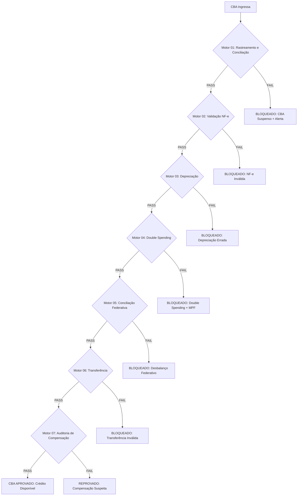

# **MOTORES DE DECISÃO - COMITÊ GESTOR DO IBS (Imposto sobre Bens e Serviços)**
**Versão:** 2.0 | **Classificação:** Restrito / Automação de Conciliação Tributária Federativa
**Responsável:** Comitê Gestor do Imposto sobre Bens e Serviços (IBS)
**Última Atualização:** 2024-11-15

---

## **📌 Visão Geral**

O **COMITÊ GESTOR DO IBS** utiliza **7 Motores de Decisão Automatizados** para **rastrear, validar e conciliar** os **Créditos de Bens de Ativo (CBA)** dentro da **Reforma Tributária (CBS/IBS)**. Cada motor é **imutável**, **auditável** e **assinado digitalmente** com **Criptografia Pós-Quântica (PQC - Dilithium)**.

Os motores operam em **cascata**, garantindo que cada **CBA** seja **único, válido e corretamente conciliado** entre os entes federados (União, Estados, Municípios). **Qualquer falha** resulta em **bloqueio imediato** e **alerta de auditoria cruzada**.

---

## **🔧 Motor de Decisão 01: Rastreamento de CBA e Conciliação Federativa**
**ID:** `IBS-DE-001` | **Prioridade:** Crítica | **Frequência:** Tempo Real

### **🎯 Gatilho**
- **Registro de aquisição** de um Bem de Ativo (CBA).
- **Solicitação de aproveitamento** de crédito tributário (CBA).
- **Alteração no status** do CBA (ex: baixa, venda).
- Eventos: `CBA_ACQUISITION`, `CBA_CREDIT_REQUEST`, `CBA_STATUS_CHANGE`

### **✅ Regras de Validação (AND Lógico)**

| **Regra**               | **Descrição**                                                                                     | **Fórmula**                                                                                     | **Tolerância** | **Código de Erro**          |
|-------------------------|-------------------------------------------------------------------------------------------------|------------------------------------------------------------------------------------------------|----------------|-----------------------------|
| `Asset_Lifecycle_Check` | O bem deve possuir **registro de origem** (NF-e válida) e **não ter sido baixado/vendido**.    | `Asset.NF_e != NULL && Asset.Status != "BAIXADO" && Asset.Status != "VENDIDO"`                 | -              | `CBA_SEM_ORIGEM`            |
| `Federative_Reconciliation` | O valor do crédito reivindicado deve **corresponder exatamente** ao valor de IBS/CBS destacado na NF-e, **ajustado pela depreciação linear**. | `CreditValue == (NF_e.IBS_Value - (NF_e.IBS_Value * Asset.DepreciationRate * Asset.AgeInYears))` | ±0.01%          | `VALOR_CREDITO_INCORRETO`   |
| `No_Double_Spending`    | O `CBA_ID` **não pode ter sido utilizado** como garantia ou crédito em outro subledger.         | `CBARegistry.Contains(CBA_ID) == FALSE`                                                         | -              | `DOUBLE_SPENDING_DETECTADO` |
| `Owner_Validation`       | O solicitante deve ser o **proprietário legítimo** do CBA.                                     | `Solicitante.CNPJ == Asset.Owner.CNPJ`                                                          | -              | `PROPRIETARIO_INVALIDO`     |

### **🔄 Ações do Motor**

#### **✅ SE PASS (Todas as regras válidas)**
1. **Crédito tokenizado** e disponibilizado no **subledger do contribuinte** para compensação futura.
2. **Registro de ciclo de vida do ativo gerado:**
   ```json
   {
     "CBA_ID": "{UUID_v4}",
     "origem_nf_hash": "SHA256(NF_e)",
     "valor_credito_ajustado": {Value},
     "status_lifecycle": "ATIVO" | "BAIXADO" | "VENDIDO",
     "timestamp_validacao": "{ISO_8601}",
     "assinatura_PQC": "Dilithium_Signature(Hash, HSM_PrivateKey)"
   }
   ```
3. **Evento** `CBA_APROVADO` enviado ao **Painel de Conciliação Federativa**.

#### **❌ SE FAIL (Qualquer regra falha)**
1. **Crédito marcado como** `SUSPENDED`.
2. **Alerta para auditoria cruzada** gerado:
   ```json
   {
     "event_type": "CBA_SUSPENSO",
     "CBA_ID": "{UUID_v4}",
     "failed_rule": "{Rule_Name}",
     "error_code": "{Error_Code}",
     "timestamp": "{ISO_8601}",
     "solicitante_cnpj": "{CNPJ}",
     "details": "{Error_Details}"
   }
   ```
3. **Notificação** enviada ao **Comitê Gestor IBS**, **Receita Federal** e **Secretarias Estaduais**.

### **📄 Saída Auditável**
- **Formato:** JSON + Assinatura PQC (Dilithium)
- **Armazenamento:** Subledger Imutável (WORM) + Backup em Fita Magnética
- **Retenção:** 10 anos (padrão Comitê IBS)
- **Exportação:** PDF (assinado), JSON (API), XML (Padrão Comitê IBS)

---

## **🔧 Motor de Decisão 02: Validação de NF-e (Nota Fiscal Eletrônica)**
**ID:** `IBS-DE-002` | **Prioridade:** Crítica | **Frequência:** Tempo Real

### **🎯 Gatilho**
- **Registro de CBA** sem NF-e válida.
- **Solicitação de crédito** com NF-e suspeita.

### **✅ Regras de Validação**

| **Regra**               | **Descrição**                                                                                     | **Fórmula**                                                                                     | **Código de Erro**          |
|-------------------------|-------------------------------------------------------------------------------------------------|------------------------------------------------------------------------------------------------|-----------------------------|
| `NF_e_Existence`        | Deve existir uma **NF-e válida** vinculada ao CBA.                                               | `Asset.NF_e != NULL`                                                                             | `NF_E_AUSENTE`              |
| `NF_e_Validity`         | A NF-e deve estar **ativa e não cancelada**.                                                     | `NF_e.Status == "AUTORIZADA" && NF_e.Cancellation == NULL`                                      | `NF_E_INVALIDA`             |
| `NF_e_Signature`        | A NF-e deve ter **assinatura digital válida** (ICP-Brasil).                                      | `VerifySignature(NF_e, Issuer_Certificate) == TRUE`                                            | `ASSINATURA_NF_E_INVALIDA`  |
| `NF_e_IBS_Value`        | A NF-e deve ter **valor de IBS/CBS destacado**.                                                  | `NF_e.IBS_Value != NULL && NF_e.IBS_Value > 0`                                                  | `VALOR_IBS_AUSENTE`         |
| `NF_e_Issuer`           | A NF-e deve ser emitida por um **emitente autorizado**.                                          | `NF_e.Issuer.CNPJ.Includes(AuthorizedIssuers) == TRUE`                                          | `EMITENTE_NAO_AUTORIZADO`   |

### **🔄 Ações do Motor**

#### **✅ SE PASS**
1. **NF-e aprovada** e vinculada ao CBA.

#### **❌ SE FAIL**
1. **CBA bloqueado** até regularização da NF-e.
2. **Notificação** enviada ao **emitente da NF-e** e ao **Comitê IBS**.

### **📄 Saída Auditável**
```json
{
  "CBA_ID": "{UUID_v4}",
  "nf_e_hash": "SHA256(NF_e)",
  "nf_e_status": "VALIDA" | "INVALIDA",
  "ibs_value": {Value},
  "timestamp": "{ISO_8601}",
  "assinatura_PQC": "{Dilithium_Signature}"
}
```

---

## **🔧 Motor de Decisão 03: Cálculo de Depreciação Linear (CBA)**
**ID:** `IBS-DE-003` | **Prioridade:** Alta | **Frequência:** Anual (ou sob demanda)

### **🎯 Gatilho**
- **Fim do ano fiscal** (31/12).
- **Solicitação de aproveitamento de crédito** (para recalcular depreciação).

### **✅ Regras de Validação**

| **Regra**               | **Descrição**                                                                                     | **Fórmula**                                                                                     | **Código de Erro**          |
|-------------------------|-------------------------------------------------------------------------------------------------|------------------------------------------------------------------------------------------------|-----------------------------|
| `Depreciation_Rate`     | A taxa de depreciação deve ser **compatível com a vida útil do bem** (ex: 20% para máquinas).  | `Asset.DepreciationRate == (1 / Asset.UsefulLife)`                                             | `TAXA_DEPRECIACAO_INVALIDA` |
| `Depreciation_Accuracy` | O cálculo da depreciação deve ser **preciso** (sem arredondamentos inadequados).             | `DepreciationValue == (Asset.OriginalValue * DepreciationRate)`                                | `CALCULO_DEPRECIACAO_ERRADO`|
| `Accumulated_Depreciation` | A depreciação acumulada **não pode exceder o valor original** do bem.                     | `AccumulatedDepreciation <= Asset.OriginalValue`                                               | `DEPRECIACAO_ACUMULADA_EXCESSIVA` |
| `Depreciation_Log`      | Todas as depreciações devem ser **registradas** no ledger imutável.                           | `DepreciationLog.Contains(Asset.CBA_ID) == TRUE`                                               | `LOG_DEPRECIACAO_FALTANTE` |

### **🔄 Ações do Motor**

#### **✅ SE PASS**
1. **Depreciação aplicada** e valor do CBA **recalculado**.
2. **Registro de depreciação** gravado no **Subledger Imutável**.

#### **❌ SE FAIL**
1. **Depreciação bloqueada**.
2. **Notificação** enviada ao **contribuinte** e ao **Comitê IBS**.

### **📄 Saída Auditável**
```json
{
  "CBA_ID": "{UUID_v4}",
  "depreciation_year": {Year},
  "depreciation_rate": {Rate},
  "depreciation_value": {Value},
  "accumulated_depreciation": {Value},
  "remaining_value": {Value},
  "timestamp": "{ISO_8601}",
  "assinatura_PQC": "{Dilithium_Signature}"
}
```

---

## **🔧 Motor de Decisão 04: Prevenção de Double Spending (Uso Duplo de CBA)**
**ID:** `IBS-DE-004` | **Prioridade:** Crítica | **Frequência:** Tempo Real

### **🎯 Gatilho**
- **Tentativa de uso** de um **CBA_ID** em mais de um subledger.
- **Solicitação de compensação** de crédito já utilizado.

### **✅ Regras de Validação**

| **Regra**               | **Descrição**                                                                                     | **Fórmula**                                                                                     | **Código de Erro**          |
|-------------------------|-------------------------------------------------------------------------------------------------|------------------------------------------------------------------------------------------------|-----------------------------|
| `CBA_Usage_Check`       | O **CBA_ID** não pode estar **em uso** em outro subledger.                                       | `CBARegistry.InUse(CBA_ID) == FALSE`                                                            | `CBA_EM_USO`                |
| `CBA_Status_Check`      | O **CBA_ID** deve estar **ATIVO** (não baixado, vendido ou suspenso).                            | `CBA.Status == "ATIVO"`                                                                         | `CBA_NAO_ATIVO`             |
| `Subledger_Interlock`   | Os subledgers devem ter **mecanismo de bloqueio mútuo** (interlock).                            | `SubledgerA.Lock(CBA_ID) && SubledgerB.Lock(CBA_ID)`                                             | `INTERLOCK_FALHOU`          |
| `Usage_Log`             | Todas as tentativas de uso de CBA devem ser **registradas**.                                    | `UsageLog.Contains(CBA_ID) == TRUE`                                                             | `LOG_USO_FALTANTE`          |

### **🔄 Ações do Motor**

#### **✅ SE PASS**
1. **CBA bloqueado** no subledger de destino.
2. **Crédito compensado** automaticamente.

#### **❌ SE FAIL**
1. **Tentativa de uso bloqueada**.
2. **Alerta de "Double Spending"** gerado:
   ```json
   {
     "event_type": "DOUBLE_SPENDING_ATTEMPT",
     "CBA_ID": "{UUID_v4}",
     "first_subledger": "{Subledger_A}",
     "second_subledger": "{Subledger_B}",
     "timestamp": "{ISO_8601}",
     "solicitante_cnpj": "{CNPJ}",
     "assinatura_PQC": "{Dilithium_Signature}",
     "notified_entities": ["COMITE_IBS", "RECEITA_FEDERAL", "MPF"]
   }
   ```
3. **Notificação** enviada ao **MPF (Ministério Público Federal)** para investigação.

---

## **🔧 Motor de Decisão 05: Conciliação Automática entre Bases (Estadual vs Federal)**
**ID:** `IBS-DE-005` | **Prioridade:** Crítica | **Frequência:** Diária (02:00 UTC-3)

### **🎯 Gatilho**
- **Fim do dia fiscal** (00:00 UTC-3).
- **Solicitação manual** de conciliação.

### **✅ Regras de Validação**

| **Regra**               | **Descrição**                                                                                     | **Fórmula**                                                                                     | **Código de Erro**          |
|-------------------------|-------------------------------------------------------------------------------------------------|------------------------------------------------------------------------------------------------|-----------------------------|
| `State_Federal_Match`   | Os valores de CBA **devem bater** entre as bases estadual e federal.                          | `Sum(State.CBA_Values) == Sum(Federal.CBA_Values)`                                               | `DESBALANCO_ESTADUAL_FEDERAL` |
| `CBA_Count_Match`        | A **quantidade de CBAs** deve ser a mesma em ambas as bases.                                    | `State.CBA_Count == Federal.CBA_Count`                                                          | `QUANTIDADE_CBA_DIVERGENTE`  |
| `Depreciation_Match`    | A **depreciação acumulada** deve ser calculada da mesma forma em ambas as bases.              | `State.AccumulatedDepreciation == Federal.AccumulatedDepreciation`                             | `DEPRECIACAO_DIVERGENTE`    |
| `Owner_Match`           | O **proprietário do CBA** deve ser o mesmo em ambas as bases.                                   | `State.CBA_Owner == Federal.CBA_Owner`                                                          | `PROPRIETARIO_DIVERGENTE`   |

### **🔄 Ações do Motor**

#### **✅ SE PASS**
1. **Conciliação aprovada**.
2. **Relatório de conciliação** gerado e assinado com PQC.

#### **❌ SE FAIL**
1. **Conciliação reprovada**.
2. **Alerta de "Desbalanço Federativo"** enviado ao **Comitê IBS**, **Receita Federal** e **Secretarias Estaduais**.
3. **Auditoria manual** solicitada.

### **📄 Saída Auditável**
```json
{
  "conciliation_id": "{UUID_v4}",
  "conciliation_date": "{YYYY-MM-DD}",
  "state_total": {Value},
  "federal_total": {Value},
  "match_status": "CONCILIADO" | "DESBALANCO",
  "discrepancies": [{"type": "VALOR" | "QUANTIDADE" | "DEPRECIACAO", "value": {Difference}}],
  "timestamp": "{ISO_8601}",
  "assinatura_PQC": "{Dilithium_Signature}"
}
```

---

## **🔧 Motor de Decisão 06: Validação de Propriedade e Transferência de CBA**
**ID:** `IBS-DE-006` | **Prioridade:** Alta | **Frequência:** Event-Driven

### **🎯 Gatilho**
- **Solicitação de transferência** de CBA entre empresas.
- **Alteração de propriedade** do CBA (ex: venda, fusão).

### **✅ Regras de Validação**

| **Regra**               | **Descrição**                                                                                     | **Fórmula**                                                                                     | **Código de Erro**          |
|-------------------------|-------------------------------------------------------------------------------------------------|------------------------------------------------------------------------------------------------|-----------------------------|
| `Transfer_Authorization`| A transferência deve ser **autorizada** pelo Comitê Gestor IBS.                                  | `Transfer.Authorization == "APPROVED"`                                                         | `TRANSFERENCIA_NAO_AUTORIZADA` |
| `Buyer_Validation`      | O comprador deve ser **uma empresa válida** (CNPJ ativo).                                       | `Buyer.CNPJ.Status == "ACTIVE"`                                                                 | `COMPRADOR_INVALIDO`        |
| `Seller_Validation`     | O vendedor deve ser o **proprietário legítimo** do CBA.                                           | `Seller.CNPJ == Asset.Owner.CNPJ`                                                               | `VENDEDOR_NAO_PROPRIETARIO` |
| `Transfer_Fee`          | Deve ser paga a **taxa de transferência** (se aplicável).                                        | `Transfer.FeePaid == TRUE`                                                                     | `TAXA_NAO_PAGA`             |
| `Transfer_Log`          | A transferência deve ser **registrada** no ledger imutável.                                      | `TransferLog.Contains(CBA_ID) == TRUE`                                                         | `LOG_TRANSFERENCIA_FALTANTE`|

### **🔄 Ações do Motor**

#### **✅ SE PASS**
1. **Transferência executada**.
2. **Propriedade do CBA atualizada** em todos os subledgers.

#### **❌ SE FAIL**
1. **Transferência bloqueada**.
2. **Notificação** enviada ao **vendedor**, **comprador** e **Comitê IBS**.

### **📄 Saída Auditável**
```json
{
  "transfer_id": "{UUID_v4}",
  "CBA_ID": "{UUID_v4}",
  "seller_cnpj": "{CNPJ}",
  "buyer_cnpj": "{CNPJ}",
  "transfer_value": {Value},
  "transfer_fee": {Value},
  "status": "EXECUTADA" | "BLOQUEADA",
  "timestamp": "{ISO_8601}",
  "assinatura_PQC": "{Dilithium_Signature}"
}
```

---

## **🔧 Motor de Decisão 07: Auditoria de Compensação de Créditos (CBA vs IBS/CBS)**
**ID:** `IBS-DE-007` | **Prioridade:** Crítica | **Frequência:** Mensal

### **🎯 Gatilho**
- **Fim do mês fiscal** (últimos 2 dias do mês).
- **Solicitação manual** de auditoria.

### **✅ Regras de Validação**

| **Regra**               | **Descrição**                                                                                     | **Fórmula**                                                                                     | **Código de Erro**          |
|-------------------------|-------------------------------------------------------------------------------------------------|------------------------------------------------------------------------------------------------|-----------------------------|
| `Credit_Compensation_Match` | O **valor compensado** deve ser **igual ao valor do crédito disponível**.               | `CompensatedValue == AvailableCreditValue`                                                     | `COMPENSACAO_EXCESSIVA`     |
| `Tax_Compliance`        | A compensação deve **respeitar as alíquotas** de IBS/CBS.                                       | `CompensatedTax == (IBS_Aliquota + CBS_Aliquota)`                                                | `ALIQUOTA_INVALIDA`          |
| `No_Negative_Balance`   | A compensação **não pode gerar saldo negativo** no subledger.                                   | `Subledger.Balance >= 0`                                                                         | `SALDO_NEGATIVO`             |
| `Compensation_Log`      | Todas as compensações devem ser **registradas** no ledger imutável.                           | `CompensationLog.Contains(CompensationID) == TRUE`                                              | `LOG_COMPENSACAO_FALTANTE`  |

### **🔄 Ações do Motor**

#### **✅ SE PASS**
1. **Auditoria aprovada**.
2. **Relatório de compensação** gerado e assinado com PQC.

#### **❌ SE FAIL**
1. **Auditoria reprovada**.
2. **Compensações suspeitas bloqueadas**.
3. **Notificação** enviada ao **Comitê IBS**, **Receita Federal** e **MPF**.

### **📄 Saída Auditável**
```json
{
  "audit_id": "{UUID_v4}",
  "audit_period": "{YYYY-MM}",
  "compensations_audited": {Count},
  "compensations_approved": {Count},
  "compensations_rejected": {Count},
  "total_compensated_value": {Value},
  "status": "APROVADA" | "REPROVADA",
  "discrepancies": [{"compensation_id": "{ID}", "error": "{Error}"}],
  "timestamp": "{ISO_8601}",
  "assinatura_PQC": "{Dilithium_Signature}"
}
```

---

## **📊 Fluxograma de Execução dos Motores**



---

## **🔐 Segurança e Assinaturas**

- **Todos os logs** são assinados com **CRYSTALS-Dilithium (PQC)**.
- **Todos os hashes** são encadeados no **Subledger Imutável (WORM)**.
- **Todos os CBAs** são **tokenizados** e **bloqueados** para evitar double spending.
- **Todas as transferências** são validadas com **Multi-Sig (Assinatura Múltipla)**.

---

## **📞 Contatos para Suporte**

| **Tipo**               | **Contato**                          | **Email**                          | **Telefone**       |
|------------------------|--------------------------------------|------------------------------------|--------------------|
| **Suporte Técnico**    | Equipe LOWDATAESC                    | suporte@lowdataesc.gov.br          | +55 (61) 9999-9999 |
| **Comitê Gestor IBS**   | Comitê Gestor do IBS                 | comiteibs@fazenda.gov.br           | +55 (61) 3412-3000 |
| **Emergências**        | SOC (Security Operations Center)     | soc@lowdataesc.gov.br              | +55 (61) 9999-0000 |
| **Receita Federal**    | Secretaria da Receita Federal        | ibs@fazenda.gov.br                 | +55 (61) 3412-4000 |

---

**⚠️ Aviso:**
Este documento é **restrito** e destina-se **exclusivamente** ao uso interno do **Comitê Gestor do IBS** e parceiros autorizados. A divulgação não autorizada é **proibida por lei** (Lei de Improbidade Administrativa - Lei 8.429/1992).

---

**🏛️ LOWDATAESC v2.0 | COMITÊ GESTOR DO IBS**
*Desenvolvido em colaboração com o Comitê Gestor IBS, Serpro, Dataprev e NIST PQC Standards.*
