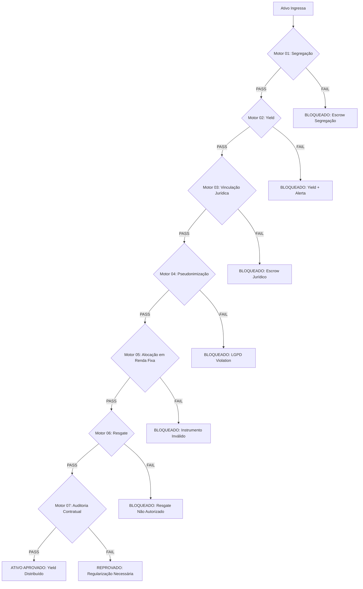

# **MOTORES DE DECISÃO - PGE-SP (Procuradoria Geral do Estado de São Paulo)**
**Versão:** 2.0 | **Classificação:** Restrito / Gestão de Ativos Públicos
**Responsável:** Procuradoria de Fazenda do Estado de São Paulo
**Última Atualização:** 2024-11-15

---

## **📌 Visão Geral**

O **PGE-SP** utiliza **7 Motores de Decisão Automatizados** para gerenciar **ativos ociosos do Estado de São Paulo**, garantindo **segregação absoluta, yield otimizado e conformidade jurídica**. Cada motor é **imutável**, **auditável** e **assinado digitalmente** com **Criptografia Pós-Quântica (PQC)**.

Os motores operam em **sequência lógica**, validando desde a **origem do ativo** até a **distribuição do yield**. Caso **qualquer motor rejeite**, o ativo é **bloqueado** e um **relatório de prova técnica jurídica** é gerado.

---

## **🔧 Motor de Decisão 01: Segregação e Alocação de Ativos (No Commingling)**
**ID:** `PGE-DE-001` | **Prioridade:** Crítica | **Frequência:** Tempo Real

### **🎯 Gatilho**
- **Ingresso de novo ativo** no pool de custódia (Dívida Ativa, Imóveis, Créditos Tributários).
- **Tentativa de movimentação** entre subledgers.
- Eventos: `ASSET_INGEST`, `ASSET_TRANSFER`, `SUBLEDGER_CHANGE`

### **✅ Regras de Validação (AND Lógico)**

| **Regra**               | **Descrição**                                                                                     | **Fórmula**                                                                                     | **Tolerância** | **Código de Erro**          |
|-------------------------|-------------------------------------------------------------------------------------------------|------------------------------------------------------------------------------------------------|----------------|-----------------------------|
| `Segregation_Check`     | O ativo **não pode ser misturado** (*commingling*) com outros tipos de ativos.                 | `Asset.SubledgerID == AssetType.SubledgerID`                                                   | -              | `COMINGLING_DETECTADO`      |
| `Unique_Subledger_ID`   | Cada ativo deve ter um **`subledger_id` único** e não reutilizado.                            | `SubledgerRegistry.Contains(Asset.SubledgerID) == FALSE`                                       | -              | `SUBLEDGER_ID_DUPLICADO`    |
| `Asset_Type_Validation` | O tipo de ativo deve ser **válido** (Dívida Ativa, Imóvel, Crédito Tributário, etc.).           | `ValidAssetTypes.Includes(Asset.Type) == TRUE`                                                  | -              | `TIPO_ATIVO_INVALIDO`       |
| `Origin_Validation`     | O ativo deve vir de uma **fonte autorizada** (ex: Receita Estadual, Secretaria de Patrimônio). | `AuthorizedSources.Includes(Asset.Origin) == TRUE`                                              | -              | `ORIGEM_NAO_AUTORIZADA`     |

### **🔄 Ações do Motor**

#### **✅ SE PASS (Todas as regras válidas)**
1. **Ativo alocado** no **subledger correspondente**.
2. **Hash gerado** com:
   ```json
   {
     "asset_id": "{UUID_v4}",
     "subledger_id": "{Subledger_ID}",
     "asset_type": "{Asset_Type}",
     "origin": "{Origin}",
     "timestamp": "{ISO_8601}",
     "hash": "SHA256(Asset_Data + Previous_Hash)",
     "assinatura_PQC": "Dilithium_Signature(Hash, HSM_PrivateKey)"
   }
   ```
3. **Ativo liberado** para o próximo motor.
4. **Evento** `ASSET_SEGREGATED` enviado ao **Painel PGE-SP**.

#### **❌ SE FAIL (Qualquer regra falha)**
1. **Ativo bloqueado** no **escrow de segregação**.
2. **Relatório de Prova Técnica Jurídica** gerado:
   ```json
   {
     "event_type": "FALHA_SEGREGACAO",
     "asset_id": "{UUID_v4}",
     "failed_rule": "{Rule_Name}",
     "error_code": "{Error_Code}",
     "timestamp": "{ISO_8601}",
     "asset_details": {
       "type": "{Asset_Type}",
       "origin": "{Origin}",
       "value": {Value}
     }
   }
   ```
3. **Notificação** enviada ao **Procurador responsável**.

### **📄 Saída Auditável**
- **Formato:** JSON + Assinatura PQC
- **Armazenamento:** Subledger Imutável (WORM) + Backup em Fita Magnética
- **Retenção:** 10 anos

---

## **🔧 Motor de Decisão 02: Yield de Ativos Ociosos (Juros Compostos)**
**ID:** `PGE-DE-002` | **Prioridade:** Alta | **Frequência:** Diária (00:00 UTC-3)

### **🎯 Gatilho**
- **Cálculo diário de yield** sobre ativos ociosos.
- **Alteração manual** na taxa de yield.

### **✅ Regras de Validação**

| **Regra**               | **Descrição**                                                                                     | **Fórmula**                                                                                     | **Código de Erro**          |
|-------------------------|-------------------------------------------------------------------------------------------------|------------------------------------------------------------------------------------------------|-----------------------------|
| `Yield_Calculation`     | O yield deve ser calculado **corretamente** (juros compostos).                                | `Yield = Principal * (1 + DailyRate) ^ Days`                                                    | `YIELD_CALCULO_ERRADO`      |
| `Rate_Compliance`       | A taxa de yield deve **respeitar os limites contratuais** (ex: máximo 100% do CDI).          | `DailyRate <= MaxAllowedRate`                                                                   | `TAXA_YIELD_INVALIDA`       |
| `Hierarchy_Compliance`  | A distribuição do yield deve **respeitar a hierarquia contratual** (60% Estado, 40% FGAO).    | `(Estado_Yield / Total_Yield) == 0.6 && (FGAO_Yield / Total_Yield) == 0.4`                     | `HIERARQUIA_YIELD_VIOLADA` |
| `Subledger_Yield_Match` | O yield de cada subledger deve **corresponder ao saldo disponível**.                         | `Subledger_Yield == Subledger_Balance * DailyRate`                                              | `YIELD_SUBLEDGER_MISMATCH`  |

### **🔄 Ações do Motor**

#### **✅ SE PASS**
1. **Yield calculado e distribuído** automaticamente.
2. **Extrato diário assinado** gerado:
   ```json
   {
     "calculation_date": "{YYYY-MM-DD}",
     "subledger_id": "{Subledger_ID}",
     "yield_diario_gerado": {Value},
     "distribuicao_percentual": {
       "Estado_SP": 60,
       "FGAO": 40
     },
     "hash_documento_vinculado": "{Document_Hash}",
     "assinatura_PQC": "{Dilithium_Signature}"
   }
   ```

#### **❌ SE FAIL**
1. **Yield bloqueado** para o subledger.
2. **Relatório de Prova Técnica Jurídica** gerado.
3. **Notificação** enviada ao **Procurador de Fazenda**.

---

## **🔧 Motor de Decisão 03: Vinculação Jurídica (Hash de Documentos)**
**ID:** `PGE-DE-003` | **Prioridade:** Crítica | **Frequência:** Tempo Real

### **🎯 Gatilho**
- **Ingresso de ativo** sem documento jurídico vinculado.
- **Tentativa de movimentação** de ativo com documento expirado.

### **✅ Regras de Validação**

| **Regra**               | **Descrição**                                                                                     | **Fórmula**                                                                                     | **Código de Erro**          |
|-------------------------|-------------------------------------------------------------------------------------------------|------------------------------------------------------------------------------------------------|-----------------------------|
| `Document_Existence`    | O ativo **deve ter um documento jurídico** vinculado (Petição, Acordo, Sentença).              | `Asset.DocumentHash != NULL`                                                                     | `DOCUMENTO_NAO_VINCULADO`   |
| `Document_Validity`     | O documento deve estar **ativo e não cancelado**.                                               | `Document.Status == "ACTIVE" && Document.ExpiryDate > CurrentDate`                             | `DOCUMENTO_INVALIDO`        |
| `Document_Hash_Integrity`| O hash do documento deve **corresponder ao original**.                                          | `SHA256(Document) == Asset.DocumentHash`                                                         | `HASH_DOCUMENTO_INVALIDO`   |
| `Document_Signature`    | O documento deve ser **assinado digitalmente** (ICP-Brasil A3).                                | `VerifySignature(Document, Signer_Certificate) == TRUE`                                         | `ASSINATURA_DOC_INVALIDA`   |

### **🔄 Ações do Motor**

#### **✅ SE PASS**
1. **Ativo liberado** para alocação em instrumentos de renda fixa.
2. **Hash do documento** gravado no **Subledger Imutável**.

#### **❌ SE FAIL**
1. **Ativo bloqueado** no **escrow jurídico**.
2. **Solicitação de regularização** enviada ao **Procurador responsável**.

### **📄 Saída Auditável**
```json
{
  "asset_id": "{UUID_v4}",
  "document_hash": "{SHA256_Hash}",
  "document_type": "PETICAO" | "ACORDO" | "SENTENCA",
  "status": "VINCULADO" | "BLOQUEADO",
  "timestamp": "{ISO_8601}",
  "assinatura_PQC": "{Dilithium_Signature}"
}
```

---

## **🔧 Motor de Decisão 04: Pseudonimização e Anonimização (LGPD)**
**ID:** `PGE-DE-004` | **Prioridade:** Alta | **Frequência:** Tempo Real

### **🎯 Gatilho**
- **Requisição de dados** para análise (ex: Data Clean Room).
- **Exportação de relatórios** com dados sensíveis.

### **✅ Regras de Validação**

| **Regra**               | **Descrição**                                                                                     | **Fórmula**                                                                                     | **Código de Erro**          |
|-------------------------|-------------------------------------------------------------------------------------------------|------------------------------------------------------------------------------------------------|-----------------------------|
| `Pseudonymization_Check`| Todos os **campos diretos** (CPF, CNPJ, Nome) devem ser **substituídos por tokens irreversíveis**. | `SensitiveFields.All(ReplacedByToken) == TRUE`                                                  | `DADOS_NAO_PSEUDONIMIZADOS` |
| `Anonymization_Check`  | Dados **anônimos** não devem permitir **reidentificação**.                                      | `ReidentificationRisk(AnonymizedData) == 0`                                                     | `RISCO_REIDENTIFICACAO`     |
| `Purpose_Limitation`    | A finalidade da requisição deve **corresponder ao consentimento**.                               | `Request.Purpose == Consent.Purpose`                                                             | `FINALIDADE_NAO_COMPATIVEL` |
| `Clean_Room_Compliance`| O processamento deve ocorrer **dentro do enclave de segurança**.                                | `ProcessingEnvironment == "Enclave"`                                                           | `AMBIENTE_NAO_SEGURO`       |

### **🔄 Ações do Motor**

#### **✅ SE PASS**
1. **Dados anonimizados liberados** para a API solicitante.
2. **Contador de "Requisições Conformidade OK"** incrementado.

#### **❌ SE FAIL**
1. **Requisição bloqueada** no gateway.
2. **Evento** `LGPD_VIOLATION_ATTEMPT` registrado.
3. **Nó requisitante adicionado à lista de bloqueio** (Gatekeeping).

### **📄 Saída Auditável**
```json
{
  "data_batch_id": "{UUID_v4}",
  "consent_hash": "{SHA256_Consent}",
  "anonymization_method": "Tokenization" | "K-Anonymity" | "Differential Privacy",
  "destination_node_hash": "{Node_Hash}",
  "timestamp": "{ISO_8601}",
  "assinatura_PQC": "{Dilithium_Signature}"
}
```

---

## **🔧 Motor de Decisão 05: Alocação em Instrumentos de Renda Fixa**
**ID:** `PGE-DE-005` | **Prioridade:** Alta | **Frequência:** Sob Demanda

### **🎯 Gatilho**
- **Solicitação de alocação** de ativo em instrumento de renda fixa (CDB, LCI, etc.).

### **✅ Regras de Validação**

| **Regra**               | **Descrição**                                                                                     | **Fórmula**                                                                                     | **Código de Erro**          |
|-------------------------|-------------------------------------------------------------------------------------------------|------------------------------------------------------------------------------------------------|-----------------------------|
| `Instrument_Validation` | O instrumento deve estar na **lista de permitidos** (ex: CDB, LCI, Tesouro Direto).           | `AllowedInstruments.Includes(Instrument.Type) == TRUE`                                         | `INSTRUMENTO_NAO_PERMITIDO` |
| `Risk_Assessment`       | O instrumento deve ter **risco compatível** com o perfil do Estado.                           | `Instrument.RiskLevel <= State.RiskTolerance`                                                   | `RISCO_ELEVADO`             |
| `Liquidity_Requirement`  | O instrumento deve ter **liquidez diária** (resgate D+0).                                       | `Instrument.Liquidity == "D+0"`                                                                 | `LIQUIDEZ_INSUFICIENTE`     |
| `Yield_Alignment`       | O rendimento do instrumento deve ser **≥ 90% do CDI**.                                            | `Instrument.Yield >= (0.9 * CDI_Rate)`                                                           | `RENDIMENTO_BAIXO`          |

### **🔄 Ações do Motor**

#### **✅ SE PASS**
1. **Ativo alocado** no instrumento.
2. **Contrato de custódia** gerado e assinado digitalmente.

#### **❌ SE FAIL**
1. **Alocação bloqueada**.
2. **Sugestões de instrumentos alternativos** apresentadas.

### **📄 Saída Auditável**
```json
{
  "asset_id": "{UUID_v4}",
  "instrument_type": "CDB" | "LCI" | "Tesouro Direto",
  "allocated_value": {Value},
  "expected_yield": {Value},
  "maturity_date": "{YYYY-MM-DD}",
  "status": "ALOCADO" | "BLOQUEADO",
  "timestamp": "{ISO_8601}",
  "assinatura_PQC": "{Dilithium_Signature}"
}
```

---

## **🔧 Motor de Decisão 06: Monitoramento de Liquidez e Resgate**
**ID:** `PGE-DE-006` | **Prioridade:** Média | **Frequência:** Diária

### **🎯 Gatilho**
- **Solicitação de resgate** de ativo alocado.
- **Vencimento de instrumento** de renda fixa.

### **✅ Regras de Validação**

| **Regra**               | **Descrição**                                                                                     | **Fórmula**                                                                                     | **Código de Erro**          |
|-------------------------|-------------------------------------------------------------------------------------------------|------------------------------------------------------------------------------------------------|-----------------------------|
| `Liquidity_Available`   | Deve haver **liquidez suficiente** para o resgate.                                              | `AvailableLiquidity >= RequestedValue`                                                          | `LIQUIDEZ_INSUFICIENTE`     |
| `Maturity_Check`        | O instrumento deve ter **vencido** (para resgate antecipado, multa deve ser aceita).           | `Instrument.MaturityDate <= CurrentDate || EarlyRedemptionFee.Accepted == TRUE`               | `INSTRUMENTO_NAO_VENCIDO`   |
| `Authorization_Check`   | O resgate deve ser **autorizado** pelo Procurador responsável.                                  | `Redemption.Authorization == "APPROVED"`                                                        | `RESGATE_NAO_AUTORIZADO`    |
| `Destination_Validation`| O destino do resgate deve ser uma **conta autorizada** (Tesouro Estadual, FGAO).               | `AllowedAccounts.Includes(Destination.Account) == TRUE`                                         | `CONTA_DESTINO_INVALIDA`    |

### **🔄 Ações do Motor**

#### **✅ SE PASS**
1. **Resgate executado** automaticamente.
2. **Yield liquidado** e distribuído conforme hierarquia.

#### **❌ SE FAIL**
1. **Resgate bloqueado**.
2. **Notificação** enviada ao solicitante.

### **📄 Saída Auditável**
```json
{
  "redemption_id": "{UUID_v4}",
  "asset_id": "{UUID_v4}",
  "requested_value": {Value},
  "redemption_fee": {Value},
  "net_value": {Value},
  "destination_account": "{Account_ID}",
  "status": "EXECUTADO" | "BLOQUEADO",
  "timestamp": "{ISO_8601}",
  "assinatura_PQC": "{Dilithium_Signature}"
}
```

---

## **🔧 Motor de Decisão 07: Auditoria de Conformidade com Contratos**
**ID:** `PGE-DE-007` | **Prioridade:** Crítica | **Frequência:** Mensal

### **🎯 Gatilho**
- **Fim do mês fiscal** (últimos 2 dias do mês).
- **Solicitação manual** de auditoria.

### **✅ Regras de Validação**

| **Regra**               | **Descrição**                                                                                     | **Fórmula**                                                                                     | **Código de Erro**          |
|-------------------------|-------------------------------------------------------------------------------------------------|------------------------------------------------------------------------------------------------|-----------------------------|
| `Contract_Compliance`   | Todas as alocações devem **respeitar os contratos** firmados.                                | `AllAllocations.ComplyWith(ContractTerms) == TRUE`                                              | `CONTRATO_VIOLADO`          |
| `Yield_Distribution`    | A distribuição do yield deve **bater com os contratos**.                                       | `ActualDistribution == ContractualDistribution`                                                 | `DISTRIBUICAO_ERRADA`       |
| `Fee_Compliance`        | Todas as taxas (custódia, administração) devem estar **dentro dos limites contratuais**.       | `AllFees <= Contract.MaxFees`                                                                   | `TAXAS_ABUSIVAS`            |
| `Reporting_Accuracy`    | Os relatórios gerados devem **refletir a realidade**.                                         | `Report.Data == Actual.Data`                                                                     | `RELATORIO_INCORRETO`       |

### **🔄 Ações do Motor**

#### **✅ SE PASS**
1. **Auditoria aprovada**.
2. **Relatório de conformidade** gerado e assinado.

#### **❌ SE FAIL**
1. **Auditoria reprovada**.
2. **Processo de regularização** iniciado.
3. **Notificação** enviada ao **Procurador-Geral do Estado**.

### **📄 Saída Auditável**
```json
{
  "audit_id": "{UUID_v4}",
  "audit_period": "{YYYY-MM}",
  "compliance_status": "APROVADO" | "REPROVADO",
  "non_compliances": [{"rule": "{Rule_Name}", "details": "{Details}"}],
  "timestamp": "{ISO_8601}",
  "assinatura_PQC": "{Dilithium_Signature}"
}
```

---

## **📊 Fluxograma de Execução dos Motores**



---

## **🔐 Segurança e Assinaturas**

- **Todos os logs** são assinados com **CRYSTALS-Dilithium (PQC)**.
- **Todos os hashes** são encadeados no **Subledger Imutável (WORM)**.
- **Todos os acessos** são registrados com **MFA + Biometria + Certificado ICP-Brasil A3**.

---

## **📞 Contatos para Suporte**

| **Tipo**               | **Contato**                          | **Email**                          | **Telefone**       |
|------------------------|--------------------------------------|------------------------------------|--------------------|
| **Suporte Técnico**    | Equipe LOWDATAESC                    | suporte@lowdataesc.gov.br          | +55 (11) 9999-9999 |
| **Gestão de Ativos**   | Procuradoria de Fazenda SP           | fazenda@pge.sp.gov.br              | +55 (11) 3123-4567 |
| **Emergências**        | SOC (Security Operations Center)     | soc@lowdataesc.gov.br              | +55 (11) 9999-0000 |

---

**⚠️ Aviso:**
Este documento é **restrito** e destina-se **exclusivamente** ao uso interno da **PGE-SP** e parceiros autorizados. A divulgação não autorizada é **proibida por lei**.

---

**🏛️ LOWDATAESC v2.0 | PGE-SP - Procuradoria Geral do Estado de São Paulo**
*Desenvolvido em colaboração com o Serpro, Dataprev e NIST PQC Standards.*
