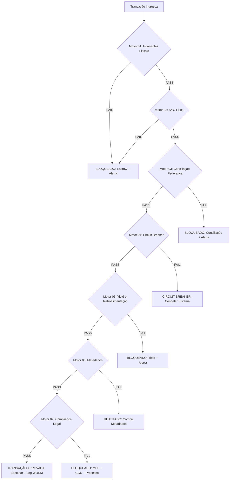

# **MOTORES DE DECISÃO - TCU (Tribunal de Contas da União)**
**Versão:** 2.0 | **Classificação:** Restrito / Automação de Auditoria
**Responsável:** SEFTI (Secretaria de Fiscalização de Tecnologia da Informação)
**Última Atualização:** 2024-11-15

---

## **📌 Visão Geral**

O **TCU** utiliza **7 Motores de Decisão Automatizados** para validar, auditá e aprovar/rejeitar transações fiscais no âmbito da **Reforma Tributária (CBS/IBS, CBA)**. Cada motor é **imutável**, **auditável** e **assinado digitalmente** com **Criptografia Pós-Quântica (PQC)**.

Os motores operam em **cascata**: uma transação deve ser aprovada por **todos os motores relevantes** para ser executada. Caso **qualquer motor rejeite**, a transação é **bloqueada no escrow** e um **alerta de anomalia** é gerado.

---

## **🔧 Motor de Decisão 01: Auditoria de Invariantes Fiscais (CBS/IBS)**
**ID:** `TCU-DE-001` | **Prioridade:** Crítica | **Frequência:** Tempo Real

### **🎯 Gatilho**
- Ingestão de **qualquer lote de transações** com divisão de receita (Split CBS/IBS) ou repasse federativo.
- Eventos: `TRANSACTION_INGEST`, `BATCH_PROCESSING`, `FEDERAL_TRANSFER`

### **✅ Regras de Validação (AND Lógico - Todas devem passar)**

| **Regra**               | **Descrição**                                                                                     | **Fórmula**                                                                                     | **Tolerância** | **Código de Erro**          |
|-------------------------|-------------------------------------------------------------------------------------------------|------------------------------------------------------------------------------------------------|----------------|-----------------------------|
| `Invariant_Check`       | Soma de CBS + IBS + Retidos deve ser **igual** ao valor total da transação.                  | `Valor_CBS + Valor_IBS + Valor_Retido == Valor_Total_Transacao`                                   | 0.00           | `ANOMALIA_SPLIT_INVARIANTE` |
| `Temporal_Check`        | Timestamp da transação deve estar dentro da **janela fiscal vigente** (dia corrente).        | `Timestamp >= StartOfDay && Timestamp <= EndOfDay`                                              | 0s             | `ANOMALIA_TEMPORAL`         |
| `Signature_Check`       | Assinatura digital do nó originador deve ser **válida** e usar **PQC (Dilithium)**.             | `VerifySignature(Transaction, Originator_PublicKey, PQC_Dilithium) == TRUE`                     | -              | `FALHA_ASSINATURA_PQC`      |
| `Node_Authorization`     | O nó originador deve ter **permissão de escrita** no subledger correspondente.               | `Node.Permissions.Has("WRITE_SUBLEDGER") == TRUE`                                              | -              | `NODE_NAO_AUTORIZADO`       |

### **🔄 Ações do Motor**

#### **✅ SE PASS (Todas as regras válidas)**
1. **Transação marcada como** `AUDIT_OK`.
2. **Hash gerado** com:
   ```json
   {
     "tx_id": "{UUID_v4}",
     "timestamp": "{ISO_8601}",
     "invariant_result": "PASS",
     "hash_anterior": "{Previous_Hash}",
     "hash_atual": "SHA256(Transaction_Data + Previous_Hash)",
     "assinatura_PQC": "Dilithium_Signature(Hash_Atual, HSM_PrivateKey)"
   }
   ```
3. **Hash encadeado** no **Subledger Imutável (WORM)**.
4. **Transação liberada** para o próximo motor ou execução.
5. **Evento** `TRANSACTION_APPROVED` enviado ao **Painel SEFTI**.

#### **❌ SE FAIL (Qualquer regra falha)**
1. **Transação bloqueada** no **escrow** (conta de garantia).
2. **Evento de anomalia gerado:**
   ```json
   {
     "event_type": "ANOMALIA_SPLIT",
     "tx_id": "{UUID_v4}",
     "failed_rule": "{Rule_Name}",
     "error_code": "{Error_Code}",
     "timestamp": "{ISO_8601}",
     "originator_node": "{Node_ID}",
     "values": {
       "Valor_CBS": {Value},
       "Valor_IBS": {Value},
       "Valor_Retido": {Value},
       "Valor_Total_Transacao": {Value}
     }
   }
   ```
3. **Notificação push + email** enviada ao **Painel do Auditor do TCU**.
4. **Log auditável** gravado em **WORM Storage**.

### **📄 Saída Auditável**
- **Formato:** JSON + Assinatura PQC
- **Armazenamento:** Subledger Imutável (WORM) + Backup em Fita Magnética (Air-Gapped)
- **Retenção:** 10 anos (padrão TCU)
- **Exportação:** XML (Padrão TCU), JSON (API)

---

## **🔧 Motor de Decisão 02: Validação de Origem e Autenticidade (KYC Fiscal)**
**ID:** `TCU-DE-002` | **Prioridade:** Alta | **Frequência:** Tempo Real

### **🎯 Gatilho**
- Transações originadas de **nós não cadastrados** ou com **certificados digitais expirados**.
- Eventos: `NEW_NODE_REGISTRATION`, `TRANSACTION_FROM_UNKNOWN`

### **✅ Regras de Validação**

| **Regra**               | **Descrição**                                                                                     | **Fórmula**                                                                                     | **Código de Erro**          |
|-------------------------|-------------------------------------------------------------------------------------------------|------------------------------------------------------------------------------------------------|-----------------------------|
| `Node_Registry_Check`   | O nó originador deve estar **cadastrado** no **Registro de Nós do TCU**.                     | `NodeRegistry.Contains(Originator_ID) == TRUE`                                                | `NODE_NAO_CADASTRADO`       |
| `Certificate_Validity`  | O certificado digital do nó deve estar **ativo** e **não expirado**.                           | `Certificate.ExpiryDate > CurrentDate && Certificate.Status == "ACTIVE"`                      | `CERTIFICADO_EXPIRADO`      |
| `ICP_Brasil_Compliance`| O certificado deve ser **ICP-Brasil A3** (padrão governamental).                                | `Certificate.Issuer == "ICP-Brasil A3"`                                                       | `CERTIFICADO_NAO_ICPBR`     |
| `PQC_Capability`         | O nó deve suportar **Criptografia Pós-Quântica (Dilithium)**.                                   | `Node.Capabilities.Includes("PQC_Dilithium") == TRUE`                                         | `NODE_SEM_PQC`              |

### **🔄 Ações do Motor**
- **✅ SE PASS:** Nó **autorizado** a enviar transações.
- **❌ SE FAIL:** Nó **bloqueado**, transação **rejeitada**, evento `NODE_BLOQUEADO` gerado.

### **📄 Saída Auditável**
```json
{
  "node_id": "{Node_ID}",
  "certificate_hash": "SHA256(Certificate)",
  "pqc_support": true/false,
  "status": "AUTORIZADO" | "BLOQUEADO",
  "timestamp": "{ISO_8601}",
  "assinatura_PQC": "{Dilithium_Signature}"
}
```

---

## **🔧 Motor de Decisão 03: Conciliação Federativa (CBS vs IBS vs CBA)**
**ID:** `TCU-DE-003` | **Prioridade:** Crítica | **Frequência:** Diária (00:00 UTC-3)

### **🎯 Gatilho**
- **Fim do dia fiscal** (00:00 UTC-3).
- **Solicitação manual** de conciliação.

### **✅ Regras de Validação**

| **Regra**               | **Descrição**                                                                                     | **Fórmula**                                                                                     | **Código de Erro**          |
|-------------------------|-------------------------------------------------------------------------------------------------|------------------------------------------------------------------------------------------------|-----------------------------|
| `CBS_IBS_Sum_Check`     | A soma de **todos os CBS** do dia deve ser igual à soma de **todos os IBS + Retidos**.          | `Sum(CBS_All) == Sum(IBS_All + Retido_All)`                                                     | `DESBALANCO_CBS_IBS`        |
| `CBA_Reconciliation`    | Os créditos de **CBA (Crédito de Bens de Ativo)** devem estar **concilados** com as NF-es.      | `Sum(CBA_Credits) == Sum(NF_e_IBS_Values) - Depreciation`                                       | `DESBALANCO_CBA`            |
| `InterState_Transfer`   | Repasses entre estados devem **respeitar as alíquotas** definidas na Reforma Tributária.      | `Transfer.Value == (Origin_State_Aliquota * Total_Transfer)`                                  | `REPASSE_INCORRETO`        |

### **🔄 Ações do Motor**
- **✅ SE PASS:** Conciliação **aprovada**, relatório gerado.
- **❌ SE FAIL:** **Alerta de desbalanço** enviado ao **COMITÊ GESTOR IBS** e **CGU**.

### **📄 Saída Auditável**
```json
{
  "conciliation_date": "{YYYY-MM-DD}",
  "cbs_total": {Value},
  "ibs_total": {Value},
  "retido_total": {Value},
  "cba_total": {Value},
  "status": "CONCILIADO" | "DESBALANCO",
  "discrepancies": [{"type": "CBS_IBS", "value": {Difference}}],
  "assinatura_PQC": "{Dilithium_Signature}"
}
```

---

## **🔧 Motor de Decisão 04: Detecção de Anomalias em Cascata (Circuit Breaker)**
**ID:** `TCU-DE-004` | **Prioridade:** Crítica | **Frequência:** Tempo Real

### **🎯 Gatilho**
- **3 ou mais anomalias** detectadas em um **período de 5 minutos**.
- **Falha na API do Banco Central** ou **inconsistência massiva** no split do IBS.

### **✅ Regras de Validação**

| **Regra**               | **Descrição**                                                                                     | **Fórmula**                                                                                     | **Código de Erro**          |
|-------------------------|-------------------------------------------------------------------------------------------------|------------------------------------------------------------------------------------------------|-----------------------------|
| `Anomaly_Threshold`     | Mais de **2 anomalias** em 5 minutos aciona o **Circuit Breaker**.                            | `AnomalyCount(Last_5min) > 2`                                                                   | `CIRCUIT_BREAKER_ACTIVATED` |
| `BCB_API_Health`        | A API do **Banco Central** deve estar **disponível** (latência < 200ms).                       | `BCB_API.Latency < 200ms && BCB_API.Status == "HEALTHY"`                                       | `BCB_API_OFFLINE`           |
| `Massive_Split_Failure` | Mais de **10% das transações** com falha no **Invariant_Check**.                               | `(FailedTransactions / TotalTransactions) * 100 > 10`                                           | `MASSIVE_SPLIT_FAILURE`     |

### **🔄 Ações do Motor**
- **✅ SE PASS:** Sistema **continua operando normalmente**.
- **❌ SE FAIL:**
  1. **Circuit Breaker ativado** → **Todas as transações são congeladas**.
  2. **Yield e saques do escrow são pausados**.
  3. **Notificação emergencial** para **SOC, TCU, CGU, COMITÊ IBS**.
  4. **Aguardar autorização manual (Multi-Sig)** para retomar operações.

### **📄 Saída Auditável**
```json
{
  "event_type": "CIRCUIT_BREAKER_ACTIVATED",
  "trigger": "Anomaly_Threshold" | "BCB_API_Health" | "Massive_Split_Failure",
  "timestamp": "{ISO_8601}",
  "anomaly_count": {Count},
  "affected_transactions": [{Transaction_IDs}],
  "assinatura_PQC": "{Dilithium_Signature}"
}
```

---

## **🔧 Motor de Decisão 05: Auditoria de Yield e Retroalimentação**
**ID:** `TCU-DE-005` | **Prioridade:** Alta | **Frequência:** Diária (02:00 UTC-3)

### **🎯 Gatilho**
- **Cálculo diário de yield** sobre ativos ociosos.
- **Alteração manual** na taxa de yield.

### **✅ Regras de Validação**

| **Regra**               | **Descrição**                                                                                     | **Fórmula**                                                                                     | **Código de Erro**          |
|-------------------------|-------------------------------------------------------------------------------------------------|------------------------------------------------------------------------------------------------|-----------------------------|
| `Yield_Calculation`     | O yield deve ser calculado **corretamente** (juros compostos).                                | `Yield = Principal * (1 + DailyRate) ^ Days`                                                    | `YIELD_CALCULO_ERRADO`      |
| `Rate_Compliance`       | A taxa de yield deve **respeitar os limites legais** (ex: máximo 100% do CDI).               | `DailyRate <= MaxAllowedRate`                                                                   | `TAXA_YIELD_INVALIDA`       |
| `Retroalimentation_Check`| A retroalimentação deve **beneficiar todos os subledgers** proporcionalmente.                   | `Sum(Subledger_Yields) == Total_Yield`                                                          | `RETROALIMENTACAO_INJUSTA`  |

### **🔄 Ações do Motor**
- **✅ SE PASS:** Yield **aplicado** e distribuído.
- **❌ SE FAIL:** Yield **bloqueado**, auditoria **acacionada**.

### **📄 Saída Auditável**
```json
{
  "calculation_date": "{YYYY-MM-DD}",
  "total_yield": {Value},
  "subledger_distribution": [{"subledger_id": "{ID}", "yield": {Value}}],
  "rate_used": {Rate},
  "status": "APROVADO" | "BLOQUEADO",
  "assinatura_PQC": "{Dilithium_Signature}"
}
```

---

## **🔧 Motor de Decisão 06: Validação de Metadados e Documentação**
**ID:** `TCU-DE-006` | **Prioridade:** Média | **Frequência:** Tempo Real

### **🎯 Gatilho**
- **Transações com metadados incompletos** ou **documentação ausente**.

### **✅ Regras de Validação**

| **Regra**               | **Descrição**                                                                                     | **Fórmula**                                                                                     | **Código de Erro**          |
|-------------------------|-------------------------------------------------------------------------------------------------|------------------------------------------------------------------------------------------------|-----------------------------|
| `Metadata_Completeness` | A transação deve ter **todos os metadados obrigatórios**.                                      | `Transaction.Metadata.RequiredFields.All(Filled) == TRUE`                                      | `METADADOS_INCOMPLETOS`     |
| `Document_Linkage`      | Deve haver um **hash de documento** (NF-e, Contrato, etc.) vinculado.                           | `Transaction.DocumentHash != NULL`                                                              | `DOCUMENTO_NAO_VINCULADO`   |
| `Document_Validity`     | O documento vinculado deve estar **ativo e não cancelado**.                                     | `Document.Status == "ACTIVE" && Document.ExpiryDate > CurrentDate`                             | `DOCUMENTO_INVALIDO`        |

### **🔄 Ações do Motor**
- **✅ SE PASS:** Transação **prossigue** para o próximo motor.
- **❌ SE FAIL:** Transação **rejeitada**, solicitante **notificado** para corrigir.

### **📄 Saída Auditável**
```json
{
  "tx_id": "{UUID_v4}",
  "missing_fields": [{"field": "{Field_Name}"}],
  "document_status": "VALID" | "MISSING" | "INVALID",
  "status": "APROVADO" | "REJEITADO",
  "timestamp": "{ISO_8601}",
  "assinatura_PQC": "{Dilithium_Signature}"
}
```

---

## **🔧 Motor de Decisão 07: Compliance com Leis e Regulamentações (LAI, LRF, LDO)**
**ID:** `TCU-DE-007` | **Prioridade:** Crítica | **Frequência:** Tempo Real

### **🎯 Gatilho**
- **Qualquer transação** que possa **violar leis federais** (LAI, LRF, LDO).

### **✅ Regras de Validação**

| **Regra**               | **Descrição**                                                                                     | **Fórmula**                                                                                     | **Código de Erro**          |
|-------------------------|-------------------------------------------------------------------------------------------------|------------------------------------------------------------------------------------------------|-----------------------------|
| `LAI_Compliance`        | A transação não deve **violar a Lei de Acesso à Informação (LAI - Lei 12.527/2011)**.          | `Transaction.TransparencyLevel >= LAI_Requirement`                                              | `VIOLACAO_LAI`              |
| `LRF_Compliance`        | A transação deve **respeitar a Lei de Responsabilidade Fiscal (LRF - LC 101/2000)**.          | `Transaction.FiscalImpact <= AllowedLimit`                                                       | `VIOLACAO_LRF`              |
| `LDO_Compliance`        | A transação deve **estar de acordo com a Lei de Diretrizes Orçamentárias (LDO)**.             | `Transaction.BudgetAlignment == LDO_Approved`                                                   | `VIOLACAO_LDO`              |
| `Anti_Corruption`        | A transação não deve **favorecer interesses privados** (Lei de Improbidade - Lei 8.429/1992).   | `Transaction.Beneficiary != PrivateInterest`                                                     | `VIOLACAO_IMPROBIDADE`      |

### **🔄 Ações do Motor**
- **✅ SE PASS:** Transação **aprovada** para execução.
- **❌ SE FAIL:**
  1. Transação **bloqueada imediatamente**.
  2. **Alerta de compliance** enviado ao **MPF (Ministério Público Federal)** e **CGU**.
  3. **Processo administrativo** aberto automaticamente.

### **📄 Saída Auditável**
```json
{
  "tx_id": "{UUID_v4}",
  "violated_law": "LAI" | "LRF" | "LDO" | "IMPROBIDADE",
  "violation_details": "{Description}",
  "status": "BLOQUEADO",
  "timestamp": "{ISO_8601}",
  "assinatura_PQC": "{Dilithium_Signature}",
  "notified_entities": ["MPF", "CGU", "TCU"]
}
```

---

## **📊 Fluxograma de Execução dos Motores**



---

## **🔐 Segurança e Assinaturas**

- **Todos os logs** são assinados com **CRYSTALS-Dilithium (PQC)**.
- **Todos os hashes** são encadeados no **Subledger Imutável (WORM)**.
- **Todos os acessos** são registrados com **MFA + Biometria + Hardware Token**.

---

## **📞 Contatos para Suporte**

| **Tipo**               | **Contato**                          | **Email**                          | **Telefone**       |
|------------------------|--------------------------------------|------------------------------------|--------------------|
| **Suporte Técnico**    | Equipe LOWDATAESC                    | suporte@lowdataesc.gov.br          | +55 (61) 9999-9999 |
| **Auditoria (TCU)**    | SEFTI - Tribunal de Contas da União | sefti@tcu.gov.br                   | +55 (61) 3316-3000 |
| **Emergências**        | SOC (Security Operations Center)     | soc@lowdataesc.gov.br              | +55 (61) 9999-0000 |

---

**⚠️ Aviso:**
Este documento é **restrito** e destina-se **exclusivamente** ao uso interno do **TCU** e parceiros autorizados. A divulgação não autorizada é **proibida por lei**.

---

**🏛️ LOWDATAESC v2.0 | TCU - Tribunal de Contas da União**
*Desenvolvido em colaboração com o Serpro, Dataprev e NIST PQC Standards.*
