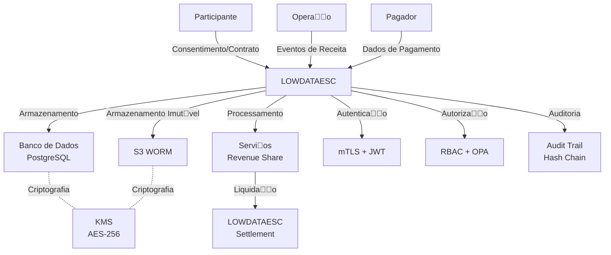

# Avaliao LGPD - Mulo Revenue Share

**Verso:** 1.0.0  
**Data:** 2024-11-02  
**Responsvel:** Arquitetura LOWDATAESC  
**Status:** Aprovado  

---

## 1. Introduo

### 1.1 Propsito
Este documento avalia a conformidade do mulo Revenue Share com a **Lei Geral de Proteo de Dados Pessoais (LGPD - Lei 13.709/2018)**, identificando:
- Dados pessoais processados
- Base legal para cada processamento
- Medidas de segurana implementadas
- Riscos e mitigaes
- Aes de conformidade

### 1.2 Escopo
Abrange todos os dados pessoais processados pelo mulo Revenue Share, incluindo:
- Dados de participantes (fundadores, investidores, operaes)
- Dados de usurios do sistema
- Dados de eventos de receita (quando contiverem dados pessoais)
- Dados de auditoria

### 1.3 Base Legal
- **LGPD:** Lei 13.709/2018
- **Regulamentao:** Decreto 10.474/2020
- **ANPD:** Autoridade Nacional de Proteo de Dados

---

## 2. Classificao de Dados

### 2.1 Dados Pessoais Processados

| Categoria | Tipo | Sensvel? | Exemplo | Base Legal | Reteno |
|-----------|------|-------------|---------|------------|-----------|
| **Participantes** | Nome | No | Fundador A | Contrato | 7 anos |
| | CPF/CNPJ | Sim | 123.456.789-00 | Contrato | 7 anos |
| | E-mail | No | contato@participante.com | Contrato | 7 anos |
| | Telefone | No | +55 11 1234-5678 | Contrato | 7 anos |
| | Endereo | No | Av. Paulista, 1234 | Contrato | 7 anos |
| | Dados bancrios | Sim | Conta corrente | Contrato | 7 anos |
| **Usurios** | Nome | No | Usurio A | Consentimento | 7 anos |
| | E-mail | No | usuario@lowdataesc.com | Consentimento | 7 anos |
| | CPF | Sim | 123.456.789-00 | Consentimento | 7 anos |
| | Device Fingerprint | No | Hash do dispositivo | Legtimo interesse | 7 anos |
| | IP Address | No | 192.168.1.1 | Legtimo interesse | 1 ano |
| **Eventos** | Dados do pagador | Sim | Nome do cliente | Consentimento | 7 anos |
| | Dados do beneficirio | Sim | Nome do beneficirio | Contrato | 7 anos |

### 2.2 Dados Sensveis
Dados que requerem proteo especial:
- CPF/CNPJ
- Dados bancrios
- Dados de pagadores/beneficirios (quando identificveis)

---

## 3. Base Legal por Processamento

### 3.1 Consentimento (Art. 7o, I)
**Aplicabilidade:** Dados de usurios e participantes no essenciais para a operao.

**Processamentos:**
- Cadastro de usurios do sistema
- Dados de participantes (quando no cobertos por contrato)
- Dados de pagadores em eventos de receita

**Requisitos:**
- Consentimento livre, informado e inequvoc
- Possibilidade de revogao
- Registro do consentimento
- Informao clara sobre finalidade

---

### 3.2 Contrato (Art. 7o, V)
**Aplicabilidade:** Dados necessrios para execuo de contrato.

**Processamentos:**
- Dados de participantes para distribuio de receita
- Dados de operaes para integrao
- Dados de beneficirios para liquidao

**Requisitos:**
- Contrato vlido entre as partes
- Dados estritamente necessrios para execuo
- Informao sobre processamento

---

### 3.3 Legtimo Interesse (Art. 7o, IX)
**Aplicabilidade:** Dados necessrios para segurana e fraude.

**Processamentos:**
- Device fingerprint
- IP address (para segurana)
- Logs de auditoria
- Dados de autenticao

**Requisitos:**
- Proporcionalidade
- Minimizao
- Transparncia

---

### 3.4 Cumprimento de Obrigao Legal (Art. 7o, II)
**Aplicabilidade:** Dados necessrios para conformidade regulatria.

**Processamentos:**
- Dados para auditoria (BCB, CVM, SUSEP)
- Dados para fiscalizao
- Dados para investigao de fraudes

**Requisitos:**
- Base legal clara
- Minimizao de dados
- Reteno conforme regulamentao

---

## 4. Processamento de Dados

### 4.1 Finalidades

| Finalidade | Dados Processados | Base Legal | Reteno |
|------------|-------------------|------------|-----------|
| Distribuio de receita | Participantes, matriz, eventos | Contrato | 7 anos |
| Liquidao financeira | Participantes, instrues | Contrato | 7 anos |
| Auditoria | Todos os dados | Obrigao legal | 7 anos |
| Segurana | Logs, device fingerprint | Legtimo interesse | 1-7 anos |
| Conformidade | Relatrios, dados regulatrios | Obrigao legal | 7 anos |
| Disputas | Participantes, clculos | Contrato | 7 anos |

---

### 4.2 Fluxo de Dados

---

### 4.3 Minimizao de Dados

**Princpio:** Coletar apenas dados estritamente necessrios.

**Medidas:**
- **Anonimizao:** Dados de pagadores so anonimizados quando possvel
- **Pseudonimizao:** Identificadores nicos para participantes
- **Tokenizao:** Dados sensveis so tokenizados
- **Excluso:** Dados no necessrios so excludos aps uso

---

## 5. Medidas de Segurana

### 5.1 Criptografia
- **Em Trnsito:** TLS 1.3 para todas as comunicaes
- **Em Repouso:** AES-256 (KMS) para dados sensveis
- **Chaves:** HSM ou KMS com rotao automtica

### 5.2 Controle de Acesso
- **RBAC:** Roles com permisses mnimas
- **ABAC:** Controle baseado em atributos
- **OPA:** Polticas de acesso centralizadas
- **MFA:** Autenticao multi-fator

### 5.3 Auditoria
- **Trilha de Auditoria:** Imutvel (S3 WORM + hash chain)
- **Logging:** Todos os acessos a dados pessoais
- **Monitoramento:** SIEM para deteco de anomalias

### 5.4 DLP (Data Loss Prevention)
- **Monitoramento:** Trfego de dados sensveis
- **Bloqueio:** Transferncia no autorizada
- **Classificao:** Dados por nvel de sensibilidade

---

## 6. Direitos dos Titulares

### 6.1 Direito de Acesso (Art. 18, I)
**Processo:**
1. Solicitao via canal oficial (e-mail, portal)
2. Verificao de identidade
3. Fornecimento de dados em formato estruturado
4. Prazo: 15 dias

**Implementao:**
- API de DSR (Data Subject Request)
- Portal do titular
- Processo manual para casos complexos

---

### 6.2 Direito de Retificao (Art. 18, II)
**Processo:**
1. Solicitao de correo
2. Verificao de identidade
3. Atualizao dos dados
4. Notificao de terceiros (se aplicvel)
5. Prazo: 15 dias

---

### 6.3 Direito de Excluso (Art. 18, III)
**Processo:**
1. Solicitao de excluso
2. Verificao de identidade
3. Avaliao de excees (contrato, legal, etc.)
4. Excluso ou anonimizao
5. Prazo: 15 dias

**Excees:**
- Dados necessrios para cumprimento de contrato
- Dados necessrios para conformidade legal
- Dados necessrios para exerccio regular de direitos

---

### 6.4 Direito de Portabilidade (Art. 18, IV)
**Processo:**
1. Solicitao de portabilidade
2. Verificao de identidade
3. Fornecimento de dados em formato estruturado
4. Prazo: 7 dias (formato digital)

---

### 6.5 Direito de Oposio (Art. 18, V)
**Processo:**
1. Solicitao de oposio
2. Avaliao de base legal
3. Interrupo do processamento (se aplicvel)
4. Prazo: 15 dias

---

### 6.6 Direito de Revogao do Consentimento (Art. 8o,  5o)
**Processo:**
1. Solicitao de revogao
2. Confirmao da revogao
3. Interrupo do processamento baseados em consentimento
4. Prazo: Imediato

---

## 7. RIPD (Relatrio de Impacto de Proteo de Dados)

### 7.1 Avaliao de Risco

| Processamento | Risco | Medidas de Mitigao | Residual |
|---------------|-------|---------------------------|----------|
| Armazenamento de CPF | Alto | Criptografia + RBAC | Mdio |
| Processamento de dados bancrios | Alto | Tokenizao + HSM | Mdio |
| Logs com IP address | Mdio | Anonimizao aps 1 ano | Baixo |
| Transferncia internacional | Alto | SCC + BCR | Mdio |
| Auditoria com dados pessoais | Mdio | Minimizao + criptografia | Baixo |

### 7.2 Medidas de Mitigao

1. **Criptografia:** AES-256 para dados sensveis
2. **Pseudonimizao:** Identificadores nicos para participantes
3. **Minimizao:** Coletar apenas dados necessrios
4. **Controle de Acesso:** RBAC + OPA
5. **Auditoria:** Trilha imutvel
6. **DLP:** Preveno de vazamento
7. **Treinamento:** Conscientizao de colaboradores

---

## 8. Transferncia Internacional de Dados

### 8.1 Jurisdies Envolvidas
- **Brasil:** LOWDATAESC (controladora)
- **EUA:** AWS (processadora)
- **UE:** Possveis operaes internacionais

### 8.2 Mecanismos de Transferncia
- **SCCs (Standard Contractual Clauses):** Contratos padro da Comisso Europeia
- **BCRs (Binding Corporate Rules):** Regras corporativas vinculantes (futuro)
- **Adequacy Decisions:** Decises de adequao (quando aplicvel)

### 8.3 Controles
- **AWS:** DPA (Data Processing Addendum) assinado
- **Criptografia:** Dados criptografados em trnsito e repouso
- **Auditoria:** Direito de auditoria sobre processadores
- **Notificao:** Notificao de violaes de segurana

---

## 9. Violao de Dados

### 9.1 Processo de Notificao

**Prazos:**
- **ANPD:** 2 dias teis (aps confirmao)
- **Titular:** Imediato (se alto risco)

**Processo:**
1. Deteco da violao
2. Investigao interna
3. Confirmao da violao
4. Notificao  ANPD
5. Notificao aos titulares (se aplicvel)
6. Medidas de mitigao

### 9.2 Registro de Violaes
- **Obrigatoriedade:** Todas as violaes devem ser registradas
- **Contedo:** Data, tipo, dados afetados, medidas tomadas
- **Reteno:** 5 anos

---

## 10. Governana

### 10.1 Encarregado de Dados (DPO)
**Responsabilidades:**
- Supervisionar conformidade LGPD
- Orientar sobre proteo de dados
- Receber solicitaes de titulares
- Cooperar com ANPD

**Contato:**
- Nome: [Nome do DPO]
- E-mail: dpo@lowdataesc.com
- Telefone: [Telefone]

### 10.2 Comit de Proteo de Dados
**Membros:**
- DPO
- Diretor Jurdico
- Diretor de Segurana
- Diretor de Operações

**Reunies:** Trimestrais

---

## 11. Treinamento e Conscientizao

### 11.1 Treinamentos
- **Frequncia:** Anual
- **Pblico:** Todos os colaboradores
- **Contedo:** LGPD, segurana de dados, procedimentos

### 11.2 Conscientizao
- **Campanhas:** Periódicas
- **Materiais:** Guia de boas práticas, FAQ
- **Testes:** Simulações de violações

---

## 12. Auditoria e Conformidade

### 12.1 Auditoria Interna
- **Frequência:** Anual
- **Escopo:** Todos os processos de dados pessoais
- **Metodologia:** Checklist de conformidade LGPD

### 12.2 Auditoria Externa
- **Frequência:** Bienal
- **Escopo:** Avaliação independent de conformidade
- **Certificação:** Possível selo de conformidade

### 12.3 Autoavaliação
- **Frequência:** Trimestral
- **Ferramenta:** Questionário de conformidade
- **Ação:** Plano de melhorias

---

## 13. Critérios de Aceite

- [ ] Avaliação LGPD completa
- [ ] Base legal definida para todos os processamentos
- [ ] Medidas de segurança implementadas
- [ ] Processos de DSR (Data Subject Request) funcionais
- [ ] RIPD elaborado e aprovado
- [ ] DPO designado
- [ ] Treinamentos realizados
- [ ] Auditoria de conformidade executada

---

## 14. Anexos

- [Política de Privacidade](../legal/PRIVACY-POLICY.md)
- [Termos de Uso](../legal/TERMS-OF-USE.md)
- [DPA (Data Processing Addendum)](DPA.md)
- [SCCs (Standard Contractual Clauses)](SCCS.md)
- [Registro de Processamento de Dados](DATA-PROCESSING-REGISTER.md)

---

**Aprovado por:** _________________________  
**Data:** _______________  
**Versão:** 1.0.0
