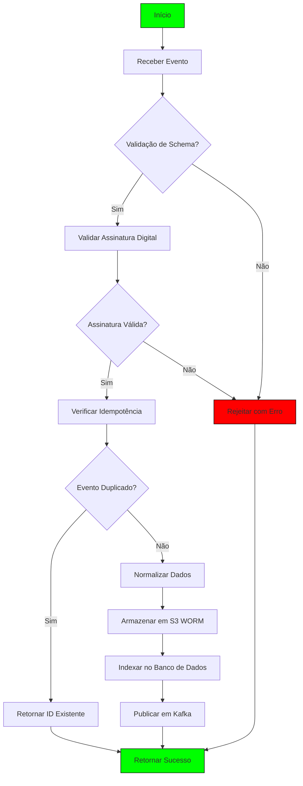
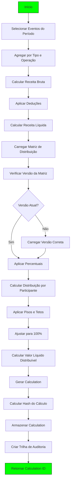
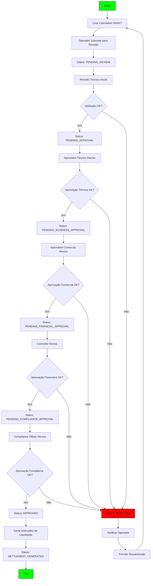
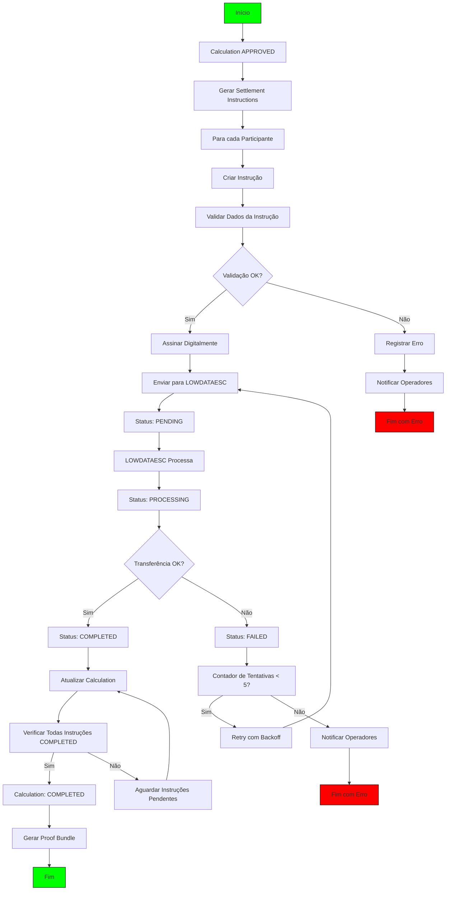
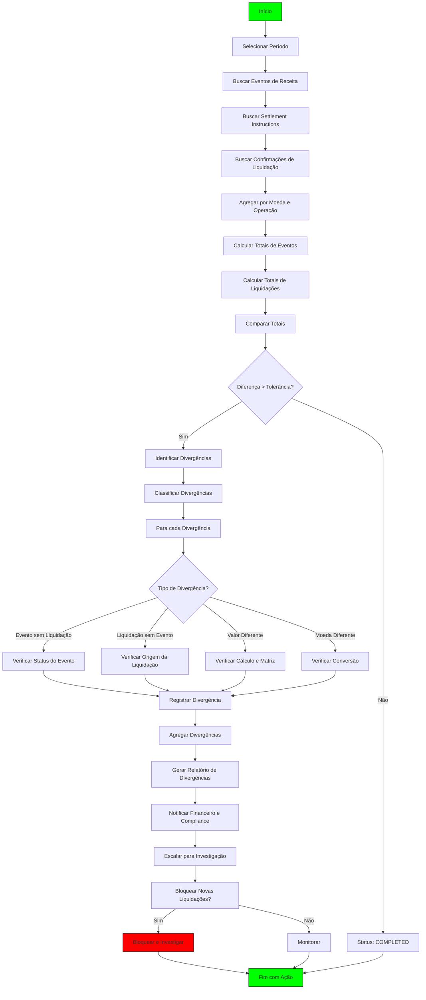
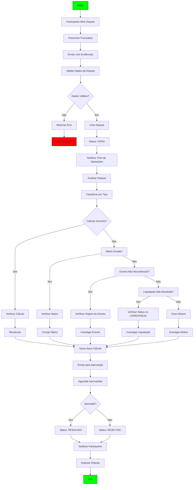
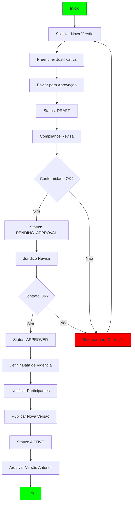
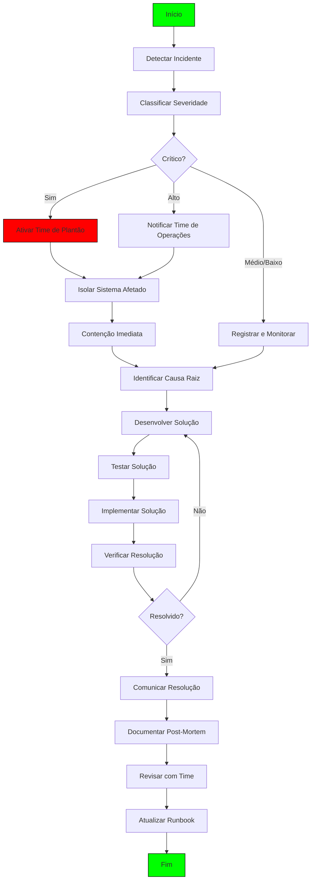

# Fluxogramas de Processo - Módulo Revenue Share

**Versão:** 1.0.0  
**Data:** 2024-11-02  
**Responsável:** Arquitetura LOWDATAESC  

---

## 1. Fluxo de Ingestão de Eventos de Receita

### Descrição Detalhada:

1. **Receber Evento**: API REST, Kafka ou Batch Upload
2. **Validação de Schema**: Verificar conformidade com `revenue_event_v1`
3. **Validar Assinatura Digital**: Verificar assinatura com chave pública do emissor
4. **Verificar Idempotência**: Usar `event_id` ou hash do payload
5. **Normalizar Dados**: Converter para schema canônico
6. **Armazenar em S3 WORM**: Imutável, 7 anos de retenção
7. **Indexar no Banco**: PostgreSQL para consultas rápidas
8. **Publicar em Kafka**: Para processamento assíncrono

---

## 2. Fluxo de Cálculo de Distribuição

### Descrição Detalhada:

1. **Selecionar Eventos**: Filtro por período, operação, tipo
2. **Agregar Eventos**: Somar valores por categoria
3. **Calcular Receita Bruta**: Σ de todos os eventos
4. **Aplicar Deduções**: Taxas, impostos, chargebacks, estornos
5. **Calcular Receita Líquida**: Receita Bruta - Deduções
6. **Carregar Matriz**: Buscar matriz ativa para o período
7. **Verificar Versão**: Garantir que a versão está correta
8. **Aplicar Percentuais**: Calcular distribuição inicial
9. **Aplicar Pisos e Tetos**: Ajustar valores conforme limites
10. **Ajustar para 100%**: Redistribuir excessos/deficiências
11. **Calcular Valor Líquido**: Receita Líquida - Reservas
12. **Gerar Calculation**: Criar entidade com todos os dados
13. **Calcular Hash**: SHA-256 do payload canônico
14. **Armazenar**: Persistir no banco de dados
15. **Criar Trilha**: Registrar ação na audit trail

---

## 3. Fluxo de Aprovação de Cálculo

### Descrição Detalhada:

1. **Criar Calculation**: Operador cria cálculo em DRAFT
2. **Submeter para Revisão**: Operador envia para revisão inicial
3. **Revisão Técnica**: Verificar dados e cálculos
4. **Aprovação Técnica**: Validar aspectos técnicos
5. **Aprovação Comercial**: Validar alinhamento com negócio
6. **Aprovação Financeira**: Validar conformidade contábil
7. **Aprovação Compliance**: Validar conformidade regulatória
8. **Gerar Instruções**: Criar settlement instructions

**Segregação de Funções:**
- Operador de Cálculo ≠ Aprovador Técnico ≠ Aprovador Comercial ≠ Controller ≠ Compliance Officer

---

## 4. Fluxo de Liquidação

### Descrição Detalhada:

1. **Calculation Aprovado**: Todas as aprovações obtidas
2. **Gerar Instruções**: Criar uma instrução por participante
3. **Validar Instrução**: Verificar dados (valor, destino, moeda)
4. **Assinar Digitalmente**: Assinatura com chave privada
5. **Enviar para LOWDATAESC**: Chamada gRPC com mTLS
6. **Processamento**: LOWDATAESC reserva e transfere valores
7. **Retry**: Até 5 tentativas com backoff exponencial
8. **Atualizar Calculation**: Marcar como SETTLEMENT_GENERATED
9. **Verificar Completude**: Todas as instruções devem estar COMPLETED
10. **Gerar Proof Bundle**: Pacote de auditoria

---

## 5. Fluxo de Reconciliação

### Descrição Detalhada:

1. **Selecionar Período**: Diário (automático) ou customizado
2. **Buscar Eventos**: Todos os eventos do período
3. **Buscar Liquidações**: Todas as instruções do período
4. **Agregar**: Por moeda e operação para comparar
5. **Calcular Totais**: Somar valores de eventos e liquidações
6. **Comparar**: Verificar se a diferença está dentro da tolerância (0.01%)
7. **Identificar Divergências**: Classificar por tipo
8. **Gerar Relatório**: Detalhar todas as divergências
9. **Notificar**: Enviar alerta para financeiro e compliance
10. **Escalar**: Iniciar investigação se necessário
11. **Bloquear**: Decisão de bloquear novas liquidações

**Tolerância**: Configurável por operação (default: 0.01%)

---

## 6. Fluxo de Gerenciamento de Disputas

### Descrição Detalhada:

1. **Abrir Disputa**: Participante submete disputa via API ou interface
2. **Preencher Formulário**: Dados da disputa e evidências
3. **Validar**: Verificar campos obrigatórios e formatação
4. **Criar Disputa**: Persistir com status OPEN
5. **Notificar**: Alertar time de operações
6. **Analisar**: Classificar por tipo de problema
7. **Investigar**: Verificar cálculo, matriz, evento ou liquidação
8. **Recalcular/Corrigir**: Ajustar conforme necessário
9. **Aprovação**: Novo workflow de aprovação para o cálculo corrigido
10. **Resolução**: Atualizar status e notificar participante

**SLA**: 5 dias úteis para resolução

---

## 7. Fluxo de Versionamento de Matriz

### Descrição Detalhada:

1. **Solicitar**: Operador ou participante solicita nova versão
2. **Justificativa**: Motivo para a mudança (novo participante, ajuste de percentuais, etc.)
3. **Revisão Compliance**: Verificar conformidade regulatória
4. **Revisão Jurídica**: Verificar conformidade contratuais
5. **Aprovação**: Assinaturas digitais de todas as partes
6. **Data de Vigência**: Definir quando a nova versão entra em vigor
7. **Notificação**: Comunicar todos os participantes
8. **Publicação**: Tornar a versão ativa no sistema
9. **Arquivamento**: Manter versão anterior para auditabilidade

---

## 8. Fluxo de Resposta a Incidentes

### Descrição Detalhada:

1. **Detectar**: Monitoramento ou relatório de usuário
2. **Classificar**: Crítico (downtime), Alto (degradação), Médio/Baixo (avisos)
3. **Ativar Time**: Plantão 24/7 para críticos
4. **Isolar**: Evitar impacto em outros sistemas
5. **Contenção**: Minimizar danos
6. **Investigar**: Encontrar causa raiz
7. **Solução**: Desenvolver e testar correção
8. **Implementar**: Deploy da solução
9. **Verificar**: Confirmar que o problema foi resolvido
10. **Documentar**: Post-mortem com lições aprendidas
11. **Revisar**: Ajustar runbooks e procedimentos

**SLA de Resposta:**
- Crítico: < 15 minutos
- Alto: < 1 hora
- Médio: < 4 horas
- Baixo: < 24 horas

---

## 9. Legenda

| Cor | Significado |
|-----|-------------|
| Verde (#00ff00) | Início/Fim |
| Vermelho (#ff0000) | Erro/Falha |
| Amarelo (#ffff00) | Aviso (opcional) |
| Azul (#0000ff) | Processo (opcional) |

| Forma | Significado |
|-------|-------------|
| Retângulo | Processo/Atividade |
| Losango | Decisão |
| Oval | Início/Fim |

---

## 10. Ferramentas para Visualização

Para visualizar os fluxogramas interativamente:

1. **Mermaid Live Editor**: https://mermaid.live
   - Copiar o código mermaid e colar no editor
   - Visualização interativa com zoom e pan

2. **VS Code com extensão Mermaid**:
   - Instalar extensão "Mermaid Preview"
   - Abrir arquivo .mmd ou .md com código mermaid
   - Visualizar diretamente no editor

3. **GitHub**:
   - Fluxogramas mermaid são renderizados automaticamente em arquivos .md

4. **Diagrams.net**:
   - Importar código mermaid
   - Editar e exportar para vários formatos

---

**Versão:** 1.0.0  
**Data:** 2024-11-02  
**Responsável:** Arquitetura LOWDATAESC
