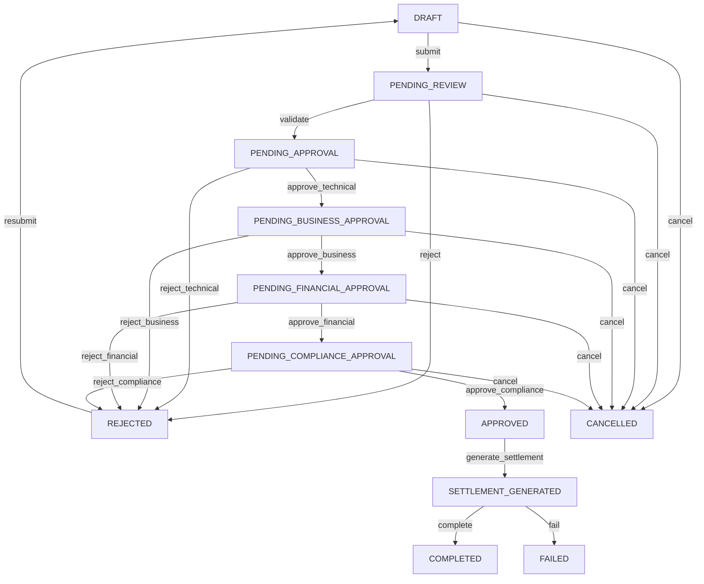
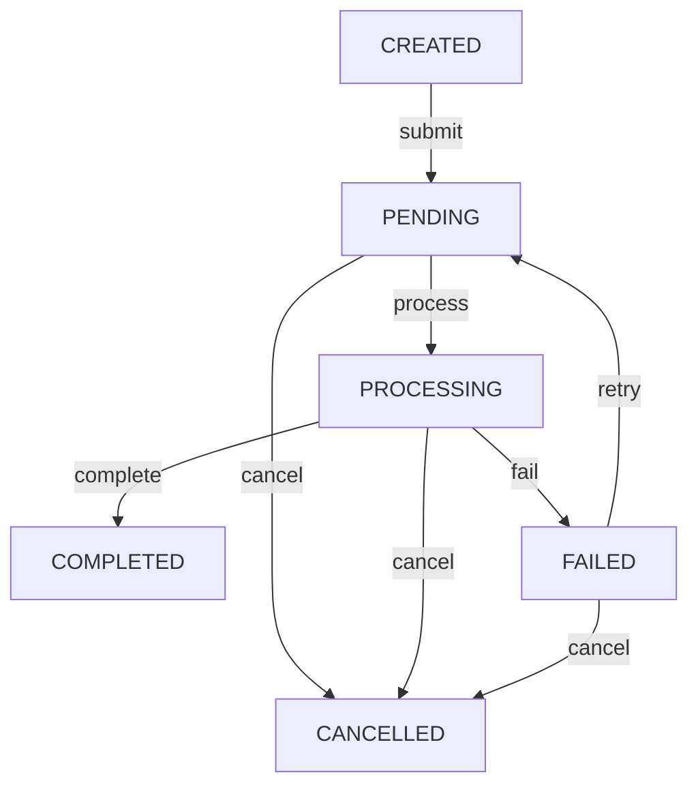

# Máquina de Estados - Módulo Revenue Share

**Versão:** 1.0.0  
**Data:** 2024-11-02  
**Responsável:** Arquitetura LOWDATAESC  
**Status:** Aprovado  

---

## 1. Introdução

### 1.1 Propósito
Este documento define os estados e transições permitidas para as entidades `calculation` e `settlement_instruction` do módulo Revenue Share, garantindo consistência, auditabilidade e conformidade com os requisitos de segregação de funções.

### 1.2 Escopo
Abrange:
- Máquina de estados para `calculation`
- Máquina de estados para `settlement_instruction`
- Transições permitidas e responsáveis
- Ações associadas a cada transição
- Regras de validação

---

## 2. Máquina de Estados - Calculation

### 2.1 Diagrama de Estados

### 2.2 Estados

| Estado | Descrição | Responsável | Ações Permitidas |
|--------|-----------|-------------|------------------|
| **DRAFT** | Cálculo criado, não submetido para revisão | Sistema/Operador de Cálculo | submit, cancel |
| **PENDING_REVIEW** | Aguardando revisão técnica inicial | Sistema/Operador de Cálculo | validate, reject, cancel |
| **PENDING_APPROVAL** | Aguardando aprovação técnica | Aprovador Técnico | approve_technical, reject_technical, cancel |
| **PENDING_BUSINESS_APPROVAL** | Aguardando aprovação comercial | Aprovador Comercial | approve_business, reject_business, cancel |
| **PENDING_FINANCIAL_APPROVAL** | Aguardando aprovação contábil/financeira | Controller | approve_financial, reject_financial, cancel |
| **PENDING_COMPLIANCE_APPROVAL** | Aguardando aprovação de compliance | Compliance Officer | approve_compliance, reject_compliance, cancel |
| **APPROVED** | Todas as aprovações obtidas | Sistema | generate_settlement, cancel |
| **SETTLEMENT_GENERATED** | Instruções de liquidação geradas | Sistema | complete, fail |
| **COMPLETED** | Cálculo e liquidação concluídos | - | - |
| **REJECTED** | Cálculo rejeitado em alguma etapa | Sistema | resubmit |
| **FAILED** | Erro na geração ou execução de liquidação | Sistema | resubmit, cancel |
| **CANCELLED** | Cálculo cancelado manualmente | - | - |

### 2.3 Transições

#### Transição: submit
- **De:** DRAFT
- **Para:** PENDING_REVIEW
- **Responsável:** Sistema/Operador de Cálculo
- **Ações:**
  - Validar dados mínimos do cálculo
  - Gerar `calculation_hash`
  - Registrar trilha de auditoria
- **Validações:**
  - Eventos de receita existentes e válidos
  - Matriz de distribuição especificada
  - Dados de cálculo preenchidos
- **Efeito:** Inicia o workflow de aprovação

#### Transição: validate
- **De:** PENDING_REVIEW
- **Para:** PENDING_APPROVAL
- **Responsável:** Sistema/Operador de Cálculo
- **Ações:**
  - Validar consistência dos dados
  - Verificar integração com eventos
  - Validar aplicação da matriz
- **Validações:**
  - Soma dos eventos = receita bruta
  - Deduções aplicadas corretamente
  - Distribuição soma 100% (ou ajuste com pisos/tetos)
- **Efeito:** Aprovação técnica inicial

#### Transição: reject
- **De:** PENDING_REVIEW
- **Para:** REJECTED
- **Responsável:** Sistema/Operador de Cálculo
- **Ações:**
  - Registrar motivo da rejeição
  - Notificar solicitante
- **Validações:**
  - Motivo obrigatório
- **Efeito:** Cálculo rejeitado, pode ser resubmetido

#### Transição: approve_technical
- **De:** PENDING_APPROVAL
- **Para:** PENDING_BUSINESS_APPROVAL
- **Responsável:** Aprovador Técnico
- **Ações:**
  - Validar cálculos técnicos
  - Verificar conformidade com especificações
  - Assinar digitalmente
- **Validações:**
  - Usuário tem role `technical_approver`
  - Segregação de funções (≠ quem calculou)
  - Assinatura digital válida
- **Efeito:** Aprovação técnica concluída

#### Transição: reject_technical
- **De:** PENDING_APPROVAL
- **Para:** REJECTED
- **Responsável:** Aprovador Técnico
- **Ações:**
  - Registrar motivo da rejeição
  - Notificar solicitante e operador de cálculo
- **Validações:**
  - Motivo obrigatório
- **Efeito:** Cálculo rejeitado, pode ser resubmetido

#### Transição: approve_business
- **De:** PENDING_BUSINESS_APPROVAL
- **Para:** PENDING_FINANCIAL_APPROVAL
- **Responsável:** Aprovador Comercial
- **Ações:**
  - Validar alinhamento com negócio
  - Verificar contratos com participantes
  - Assinar digitalmente
- **Validações:**
  - Usuário tem role `business_approver`
  - Segregação de funções (≠ quem calculou ou aprovou tecnicamente)
- **Efeito:** Aprovação comercial concluída

#### Transição: reject_business
- **De:** PENDING_BUSINESS_APPROVAL
- **Para:** REJECTED
- **Responsável:** Aprovador Comercial
- **Ações:**
  - Registrar motivo da rejeição
  - Notificar solicitante
- **Validações:**
  - Motivo obrigatório
- **Efeito:** Cálculo rejeitado, pode ser resubmetido

#### Transição: approve_financial
- **De:** PENDING_FINANCIAL_APPROVAL
- **Para:** PENDING_COMPLIANCE_APPROVAL
- **Responsável:** Controller
- **Ações:**
  - Validar conformidade contábil
  - Verificar reservas e provisões
  - Assinar digitalmente
- **Validações:**
  - Usuário tem role `financial_approver`
  - Segregação de funções
  - Conformidade com política contábil
- **Efeito:** Aprovação financeira concluída

#### Transição: reject_financial
- **De:** PENDING_FINANCIAL_APPROVAL
- **Para:** REJECTED
- **Responsável:** Controller
- **Ações:**
  - Registrar motivo da rejeição
  - Notificar solicitante
- **Validações:**
  - Motivo obrigatório
- **Efeito:** Cálculo rejeitado, pode ser resubmetido

#### Transição: approve_compliance
- **De:** PENDING_COMPLIANCE_APPROVAL
- **Para:** APPROVED
- **Responsável:** Compliance Officer
- **Ações:**
  - Validar conformidade regulatória
  - Verificar conformidade com LGPD, BCB, etc.
  - Assinar digitalmente
- **Validações:**
  - Usuário tem role `compliance_approver`
  - Segregação de funções
  - Conformidade com todas as regulamentações aplicáveis
- **Efeito:** Cálculo totalmente aprovado

#### Transição: reject_compliance
- **De:** PENDING_COMPLIANCE_APPROVAL
- **Para:** REJECTED
- **Responsável:** Compliance Officer
- **Ações:**
  - Registrar motivo da rejeição
  - Notificar solicitante
- **Validações:**
  - Motivo obrigatório
- **Efeito:** Cálculo rejeitado, pode ser resubmetido

#### Transição: generate_settlement
- **De:** APPROVED
- **Para:** SETTLEMENT_GENERATED
- **Responsável:** Sistema
- **Ações:**
  - Gerar instruções de liquidação para cada participante
  - Enviar para LOWDATAESC via Settlement Adapter
  - Registrar `settlement_instructions`
- **Validações:**
  - Cálculo está APPROVED
  - Integração com LOWDATAESC disponível
- **Efeito:** Inicia processo de liquidação

#### Transição: complete
- **De:** SETTLEMENT_GENERATED
- **Para:** COMPLETED
- **Responsável:** Sistema
- **Ações:**
  - Receber confirmação de todas as liquidações
  - Atualizar status de instruções
  - Gerar proof bundle
- **Validações:**
  - Todas as instruções estão COMPLETED
  - Reconciliação automática bem-sucedida
- **Efeito:** Cálculo e liquidação concluídos

#### Transição: fail
- **De:** SETTLEMENT_GENERATED
- **Para:** FAILED
- **Responsável:** Sistema
- **Ações:**
  - Registrar erro
  - Notificar operadores
  - Manter instruções no estado atual
- **Validações:**
  - Pelo menos uma instrução está FAILED
- **Efeito:** Cálculo falhou, pode ser resubmetido

#### Transição: resubmit
- **De:** REJECTED, FAILED
- **Para:** DRAFT
- **Responsável:** Operador de Cálculo
- **Ações:**
  - Criar nova versão do cálculo
  - Copiar dados do cálculo original
  - Resetar status
- **Validações:**
  - Usuário tem permissão para resubmeter
  - Motivo da resubmissão (opcional)
- **Efeito:** Permite correção e novo envio

#### Transição: cancel
- **De:** DRAFT, PENDING_REVIEW, PENDING_APPROVAL, PENDING_BUSINESS_APPROVAL, PENDING_FINANCIAL_APPROVAL, PENDING_COMPLIANCE_APPROVAL, APPROVED
- **Para:** CANCELLED
- **Responsável:** Solicitante ou Administrador
- **Ações:**
  - Registrar motivo do cancelamento
  - Notificar todas as partes envolvidas
  - Bloquear futuras transições
- **Validações:**
  - Motivo obrigatório
  - Usuário tem permissão para cancelar
- **Efeito:** Cálculo cancelado, não pode ser resubmetido

---

## 3. Máquina de Estados - Settlement Instruction

### 3.1 Diagrama de Estados

### 3.2 Estados

| Estado | Descrição | Responsável | Ações Permitidas |
|--------|-----------|-------------|------------------|
| **CREATED** | Instrução criada, não submetida | Sistema | submit, cancel |
| **PENDING** | Aguardando processamento pelo LOWDATAESC | Sistema | process, cancel |
| **PROCESSING** | Em processamento pelo LOWDATAESC | LOWDATAESC | complete, fail |
| **COMPLETED** | Liquidação concluída com sucesso | - | - |
| **FAILED** | Erro no processamento | Sistema | retry, cancel |
| **CANCELLED** | Instrução cancelada | - | - |

### 3.3 Transições

#### Transição: submit
- **De:** CREATED
- **Para:** PENDING
- **Responsável:** Sistema
- **Ações:**
  - Enviar instrução para LOWDATAESC
  - Registrar timestamp de envio
  - Atualizar status
- **Validações:**
  - Instrução está CREATED
  - Dados da instrução válidos
  - Conexão com LOWDATAESC disponível
- **Efeito:** Inicia processamento da liquidação

#### Transição: process
- **De:** PENDING
- **Para:** PROCESSING
- **Responsável:** LOWDATAESC
- **Ações:**
  - Iniciar processamento da instrução
  - Reservar valores em conta escrow
- **Validações:**
  - Instrução está PENDING
  - Saldo suficiente em conta escrow
  - Conta destino válida
- **Efeito:** LOWDATAESC está processando a instrução

#### Transição: complete
- **De:** PROCESSING
- **Para:** COMPLETED
- **Responsável:** LOWDATAESC
- **Ações:**
  - Transferir valores para conta destino
  - Gerar confirmação com assinatura digital
  - Enviar callback para Revenue Share
- **Validações:**
  - Transferência bem-sucedida
  - Assinatura digital válida
- **Efeito:** Liquidação concluída

#### Transição: fail
- **De:** PROCESSING
- **Para:** FAILED
- **Responsável:** LOWDATAESC
- **Ações:**
  - Registrar motivo da falha
  - Manter valores reservados (para retry)
  - Enviar callback para Revenue Share
- **Validações:**
  - Falha no processamento
- **Efeito:** Instrução falhou, pode ser tentada novamente

#### Transição: retry
- **De:** FAILED
- **Para:** PENDING
- **Responsável:** Sistema
- **Ações:**
  - Reenviar instrução para LOWDATAESC
  - Incrementar contador de tentativas
  - Aplicar backoff exponencial
- **Validações:**
  - Tentativas < limite (configurável, default: 5)
  - Erro é retriable (ex: timeout, rede)
- **Efeito:** Nova tentativa de processamento

#### Transição: cancel
- **De:** CREATED, PENDING, PROCESSING, FAILED
- **Para:** CANCELLED
- **Responsável:** Operador (com permissão)
- **Ações:**
  - Registrar motivo do cancelamento
  - Notificar LOWDATAESC (se em PROCESSING)
  - Liberar valores reservados (se aplicável)
- **Validações:**
  - Motivo obrigatório
  - Usuário tem permissão para cancelar
  - Se em PROCESSING, LOWDATAESC permite cancelamento
- **Efeito:** Instrução cancelada, não pode ser processada

---

## 4. Segregação de Funções

### 4.1 Matriz de Responsabilidades

| Função | Calculation | Settlement Instruction | Observações |
|--------|-------------|------------------------|-------------|
| **Operador de Cálculo** | submit, validate, reject, resubmit, cancel | - | Não pode aprovar |
| **Aprovador Técnico** | approve_technical, reject_technical | - | Não pode calcular ou liquidar |
| **Aprovador Comercial** | approve_business, reject_business | - | Não pode calcular, aprovar tecnicamente ou liquidar |
| **Controller** | approve_financial, reject_financial | - | Não pode calcular, aprovar tecnicamente/comercialmente ou liquidar |
| **Compliance Officer** | approve_compliance, reject_compliance | - | Não pode calcular, aprovar em outros níveis ou liquidar |
| **Sistema** | generate_settlement, complete, fail | submit, process, complete, fail, retry | Operações automáticas |
| **LOWDATAESC** | - | process, complete, fail | Processamento de liquidação |

### 4.2 Regras de Segregação

1. **Quem calcula ≠ quem aprova:**
   - Operador de Cálculo não pode aprovar em nenhum nível
   - Aprovadores não podem calcular

2. **Quem aprova ≠ quem liquida:**
   - Aprovadores não podem gerar ou processar liquidações
   - Sistema de liquidação é separado

3. **Múltiplas aprovações:**
   - Mínimo 4 níveis de aprovação (técnico, negócio, financeiro, compliance)
   - Cada nível por pessoa diferente

4. **Auditoria independente:**
   - Compliance Officer não reporta a nenhuma das outras áreas
   - Trilha de auditoria não pode ser modificada por operadores

---

## 5. Auditoria

### 5.1 Trilha de Auditoria
Todas as transições de estado devem ser registradas na trilha de auditoria com:
- `action_id`: Identificador único
- `timestamp`: Data/hora da transição
- `actor`: Quem realizeou (user_id ou service_id)
- `action`: Nome da transição (ex: approve_technical)
- `from_state`: Estado anterior
- `to_state`: Estado novo
- `resource_id`: calculation_id ou instruction_id
- `metadata`: Dados adicionais (motivo, assinatura, etc.)
- `hash`: Hash do registro anterior (para hash chain)
- `signature`: Assinatura digital do ator

### 5.2 Verificação de Integridade
- Hash chain deve ser verificável a qualquer momento
- Assinaturas digitais devem ser validadas
- Qualquer quebra na cadeia deve gerar alerta crítico

---

## 6. Exceções e Tratamento de Erros

### 6.1 Timeout de Aprovação
- **Situação:** Aprovação não concluída dentro do SLA (24h para técnico, 48h para outros)
- **Ação:**
  - Notificar o aprovador
  - Escalar para o superior hierárquico
  - Após 72h, cancelar automaticamente (configurável)

### 6.2 Erro em Cálculo
- **Situação:** Erro detectado após aprovação
- **Ação:**
  - Bloquear liquidação
  - Notificar todas as partes
  - Requerer recálculo e novo workflow de aprovação

### 6.3 Falha na Liquidação
- **Situação:** LOWDATAESC falha ao processar instrução
- **Ação:**
  - Retry automático (até 5 tentativas)
  - Após esgotar tentativas, notificar operadores
  - Instrução vai para FAILED, cálculo vai para FAILED

### 6.4 Divergência de Reconciliação
- **Situação:** Reconciliação detecta divergência > tolerância
- **Ação:**
  - Bloquear novas liquidações para o cálculo afetado
  - Notificar financeiro e compliance
  - Iniciar investigação

---

## 7. Critérios de Aceite

- [ ] Todos os estados e transições implementados conforme definido
- [ ] Segregação de funções enforcement (RBAC + workflow)
- [ ] Trilha de auditoria completa e verificável
- [ ] Tratamento de exceções implementado
- [ ] Integração com LOWDATAESC funcional
- [ ] Reconciliação automática com tolerância configurável
- [ ] Notificações para todas as transições críticas

---

## 8. Anexos

- [Matriz RACI](../governance/RACI-MATRIX.md)
- [Especificação de Integração com LOWDATAESC](../specs/LOWDATAESC-INTEGRATION.md)
- [Especificação do Hash Chain](../security/HASH-CHAIN-SPEC.md)

---

**Aprovado por:** _________________________  
**Data:** _______________  
**Versão:** 1.0.0
