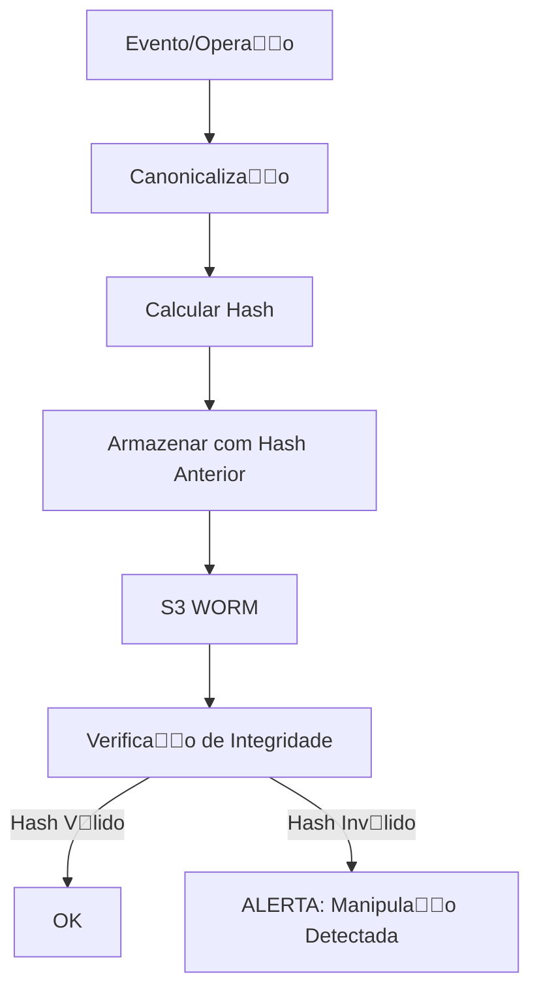

# Especificao do Hash Chain de Auditoria

**Verso:** 1.0.0  
**Data:** 2024-11-02  
**Responsvel:** Arquitetura LOWDATAESC  
**Status:** Aprovado  

---

## 1. Introduo

### 1.1 Propsito
Este documento define a implementao do **Hash Chain** para garantia de integridade da trilha de auditoria do mulo Revenue Share, permitindo:
- Verificao de integridade de todos os eventos
- Deteco de manipulao ou excluso de registros
- Auditoria imutvel e verificvel

### 1.2 Escopo
Abrange:
- Gerao do hash chain
- Canonicalizao de dados
- Armazenamento imutvel
- Verificao de integridade
- Recuperao e validao

---

## 2. Conceitos

### 2.1 Hash Chain
Cadeia de hashes onde cada registro contm o hash do registro anterior, criando uma cadeia imutvel.

**Exemplo:**
```
Hash_1 = SHA256(Record_1)
Hash_2 = SHA256(Record_2 + Hash_1)
Hash_3 = SHA256(Record_3 + Hash_2)
...
Hash_N = SHA256(Record_N + Hash_{N-1})
```

### 2.2 Canonicalizao
Processo de converter dados para um formato padronizado, determinstico, para garantir que o hash seja consistente.

### 2.3 Imutabilidade
Os registros no podem ser modificados aps serem armazenados. Qualquer modificao quebra a cadeia.

---

## 3. Arquitetura



---

## 4. Canonicalizao

### 4.1 Regras de Canonicalizao

#### JSON Canonical Form
1. **Ordem de Chaves:** Ordenar chaves em ordem alfabtica
2. **Formatao:** Sem espaos desnecessrios
3. **Valores Nulos:** Remover campos nulos
4. **Tipos:** Manter tipos consistentes (ex: nmeros no como strings)
5. **Data/Hora:** ISO 8601 com timezone UTC

#### Exemplo

**Antes:**
```json
{
  "event_id": "evt_123",
  "amount": 1000.00,
  "timestamp": "2024-11-02T10:00:00Z",
  "currency": "BRL",
  "metadata": null
}
```

**Depois (Canonical):**
```json
{"amount":1000,"currency":"BRL","event_id":"evt_123","timestamp":"2024-11-02T10:00:00Z"}
```

---

### 4.2 Implementao

**Biblioteca:** `json-canonify` (Node.js) ou implementao customizada

**Funo:**
```javascript
function canonicalize(obj) {
    // 1. Remover campos nulos
    const filtered = removeNulls(obj);
    // 2. Ordenar chaves
    const sorted = sortKeys(filtered);
    // 3. Converter para JSON sem espaos
    return JSON.stringify(sorted);
}

function removeNulls(obj) {
    if (obj === null || obj === undefined) return undefined;
    if (typeof obj !== 'object') return obj;
    
    if (Array.isArray(obj)) {
        return obj.map(removeNulls).filter(item => item !== undefined);
    }
    
    const result = {};
    for (const key of Object.keys(obj).sort()) {
        const value = removeNulls(obj[key]);
        if (value !== undefined) {
            result[key] = value;
        }
    }
    return result;
}

function sortKeys(obj) {
    if (obj === null || typeof obj !== 'object') return obj;
    
    if (Array.isArray(obj)) {
        return obj.map(sortKeys);
    }
    
    const result = {};
    for (const key of Object.keys(obj).sort()) {
        result[key] = sortKeys(obj[key]);
    }
    return result;
}
```

---

## 5. Hash Chain

### 5.1 Estrutura do Registro

```json
{
    "sequence_number": 1,
    "timestamp": "2024-11-02T10:00:00.000Z",
    "action": "ingest_event",
    "actor": "user_operation_a",
    "resource_type": "revenue_event",
    "resource_id": "evt_550e8400-e29b-41d4-a716-446655440000",
    "payload": {
        "event_id": "evt_550e8400-e29b-41d4-a716-446655440000",
        "operation_id": "op_550e8400-e29b-41d4-a716-446655440001",
        "amount": 1000.00,
        "currency": "BRL",
        "timestamp": "2024-11-02T10:00:00Z",
        "type": "sale",
        "jurisdiction": "BR",
        "source": "api"
    },
    "canonical_form": "{\"amount\":1000,\"currency\":\"BRL\",...}",
    "previous_hash": null,
    "current_hash": "a1b2c3d4e5f6...",
    "signature": "MEUCIQD..."
}
```

---

### 5.2 Clculo do Hash

**Algoritmo:** SHA-256

**Frmula:**
```
current_hash = SHA256(canonical_form + previous_hash)
```

**Exemplo:**
```javascript
const crypto = require('crypto');

function calculateHash(canonicalForm, previousHash) {
    const data = previousHash 
        ? `${canonicalForm}|${previousHash}` 
        : canonicalForm;
    return crypto.createHash('sha256').update(data).digest('hex');
}
```

---

### 5.3 Verificao de Integridade

**Processo:**
1. Recuperar o ltimo registro do hash chain
2. Recalcular o hash a partir do registro anterior
3. Comparar com o hash armazenado
4. Se diferente, a cadeia foi violada

**Funo:**
```javascript
function verifyHashChain(records) {
    let previousHash = null;
    
    for (const record of records) {
        const expectedHash = calculateHash(
            record.canonical_form,
            previousHash
        );
        
        if (expectedHash !== record.current_hash) {
            throw new Error(`Hash mismatch at sequence ${record.sequence_number}`);
        }
        
        previousHash = record.current_hash;
    }
    
    return true;
}
```

---

## 6. Armazenamento

### 6.1 S3 WORM
- **Bucket:** `lowdataesc-audit-hashchain`
- **Object Lock:** 7 anos
- **Versioning:** Habilitado
- **Criptografia:** SSE-KMS (AES-256)

### 6.2 Estrutura de Arquivos
```
/year=2024/month=11/day=02/
  hashchain_2024-11-02_000000000000_000000000001.json
  hashchain_2024-11-02_000000000001_000000000002.json
  ...
```

### 6.3 Indexao
- **Banco de Dados:** PostgreSQL (para consultas rpidas)
- **Tabela:** `audit_hashchain`
- **Campos:** `sequence_number`, `timestamp`, `action`, `actor`, `resource_type`, `resource_id`, `current_hash`, `previous_hash`

---

## 7. Tipos de Eventos

### 7.1 Eventos de Ingesto
- **Ao:** `ingest_event`
- **Recurso:** `revenue_event`
- **Payload:** Evento de receita

### 7.2 Eventos de Clculo
- **Ao:** `create_calculation`, `submit_calculation`, `approve_calculation`, `reject_calculation`
- **Recurso:** `calculation`
- **Payload:** Dados do clculo

### 7.3 Eventos de Liquidao
- **Ao:** `create_instruction`, `send_instruction`, `confirm_instruction`
- **Recurso:** `settlement_instruction`
- **Payload:** Dados da instruo

### 7.4 Eventos de Reconciliao
- **Ao:** `create_reconciliation`, `complete_reconciliation`
- **Recurso:** `reconciliation`
- **Payload:** Dados da reconciliao

### 7.5 Eventos de Disputa
- **Ao:** `create_dispute`, `resolve_dispute`, `reject_dispute`
- **Recurso:** `dispute`
- **Payload:** Dados da disputa

### 7.6 Eventos de Matriz
- **Ao:** `create_matrix`, `approve_matrix`, `activate_matrix`
- **Recurso:** `distribution_matrix`
- **Payload:** Dados da matriz

### 7.7 Eventos de Participante
- **Ao:** `create_participant`, `update_participant`, `deactivate_participant`
- **Recurso:** `participant`
- **Payload:** Dados do participante

---

## 8. Assinatura Digital

### 8.1 Chaves
- **Algoritmo:** ECDSA (P-256) ou RSA (2048 bits)
- **Armazenamento:** HSM ou Vault
- **Rotao:** Automtica a cada 90 dias

### 8.2 Processo de Assinatura
1. Gerar hash do canonical form + previous hash
2. Assinar o hash com a chave privada do ator
3. Armazenar assinatura no registro

### 8.3 Verificao de Assinatura
1. Recuperar chaves pblicas do ator
2. Verificar assinatura com a chave pblica
3. Se invlida, alertar sobre possvel fraude

---

## 9. Verificao Contnua

### 9.1 Processo
1. **Frequncia:** A cada 1000 registros ou diariamente (o que ocorrer primeiro)
2. **Escopo:** Todos os registros desde a ltima verificao
3. **Responsvel:** Audit Service
4. **Ao:** Se falhar, gerar alerta crtico

### 9.2 Alertas
- **Hash Mismatch:** Cadeia violada, possvel manipulao
- **Missing Record:** Registro excludo ou no armazenado
- **Invalid Signature:** Assinatura invlida, possvel falsificao
- **Out of Order:** Registros fora de ordem

---

## 10. Proof Bundle

### 10.1 Definio
Pacote contendo todos os registros de auditoria para um perodo, com:
- Eventos de receita
- Clculos
- Instrues de liquidao
- Reconciliaes
- Disputas
- Trilha de auditoria (hash chain)

### 10.2 Formato
- **Formato:** ZIP
- **Assinatura:** Assinatura digital do pacote
- **Hash:** Hash SHA-256 do pacote

### 10.3 Gerao
```bash
# Gerar proof bundle para um perodo
curl -X POST https://api.lowdataesc.com/revenue-share/v1/audit/proof-bundle \
  -H "Authorization: Bearer <JWT>" \
  -H "Content-Type: application/json" \
  -d '{
    "start_date": "2024-11-01T00:00:00Z",
    "end_date": "2024-11-02T23:59:59Z"
  }' \
  --output proof-bundle-2024-11.zip

# Verificar assinatura
openssl dgst -sha256 -verify public_key.pem -signature proof-bundle-2024-11.zip.sig proof-bundle-2024-11.zip
```

---

## 11. Recuperao de Desastres

### 11.1 Backup
- **Frequncia:** Contnuo (S3 versioning)
- **Reteno:** 7 anos
- **Regies:** Multi-region (sa-east-1, us-east-1)

### 11.2 Restore
- **Processo:** Recuperar do S3 e verificar hash chain
- **Teste:** Restore testado mensalmente
- **Tempo:** < 1 hora para restore completo

---

## 12. Critrios de Aceite

- [ ] Canonicalizao implementada e testada
- [ ] Hash chain funcional para todos os eventos
- [ ] Armazenamento imutvel (S3 WORM) configurado
- [ ] Verificao de integridade automtica funcional
- [ ] Assinatura digital implementada
- [ ] Proof bundle gerado e verificvel
- [ ] Recuperao de desastres testada
- [ ] Documentao completa

---

## 13. Anexos

- [Especificao de Auditoria](../governance/AUDIT-PROCEDURE.md)
- [Poltica de Segurana](./SECURITY-POLICY.md)
- [Threat Model](./THREAT-MODEL.md)

---

**Aprovado por:** _________________________  
**Data:** _______________  
**Verso:** 1.0.0
