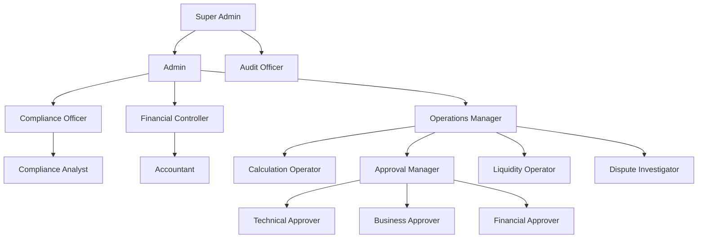

# Poltica de RBAC e Segregao de Funes - Mulo Revenue Share

**Verso:** 1.0.0  
**Data:** 2024-11-02  
**Responsvel:** Arquitetura LOWDATAESC  
**Status:** Aprovado  

---

## 1. Introduo

### 1.1 Propsito
Este documento define a poltica de **Role-Based Access Control (RBAC)** e **Segregao de Funes (SoD - Segregation of Duties)** para o mulo Revenue Share, garantindo que:
- Acesso  concedido com base no princpio do **least privilege**
- Funes crticas so segregadas para prevenir fraudes
- Todas as aes so auditveis

### 1.2 Escopo
Abrange:
- Definio de roles e permisses
- Matriz RACI (Responsible, Accountable, Consulted, Informed)
- Regras de segregao de funes
- Implementao tcnica (OPA, mTLS, JWT)

---

## 2. Princpios

### 2.1 Least Privilege
- Usurios e servios tm apenas as permisses necessrias para suas funes
- Permisses so concedidas explicitamente, nunca por default

### 2.2 Segregao de Funes (SoD)
- **Quem calcula ≠ quem aprova ≠ quem liquida ≠ quem audita**
- Nenhum usurio pode executar todas as etapas de um processo crtico
- Funes crticas so separadas por roles

### 2.3 Separation of Concerns
- Responsabilidades claras para cada role
- Processos bem definidos com checks e balances

### 2.4 Accountability
- Todas as aes so registradas na trilha de auditoria
- Assinaturas digitais para aes crticas

---

## 3. Roles e Permisses

### 3.1 Hierarquia de Roles



### 3.2 Definio de Roles

#### 3.2.1 Super Admin
**Descrio:** Acesso total ao sistema, apenas para emergncias.

**Permisses:**
- Gerenciar todos os usurios e roles
- Configurar parmetros do sistema
- Acessar todos os dados (com justificativa e audit)
- Executar operaes de manuteno

**Restries:**
- No pode executar operaes de negcio (clculo, aprovao, liquidao)
- Acesso  monitorado e auditado
- Requer MFA + aprovao de pelo menos 2 pessoas

**Usurios:** 2 (mximo)

---

#### 3.2.2 Admin
**Descrio:** Administrao do sistema e gerenciamento de usurios.

**Permisses:**
- Gerenciar usurios (criar, atualizar, desativar)
- Gerenciar roles e permisses
- Configurar limites e quotas
- Monitorar sistema

**Restries:**
- No pode executar operaes de negcio
- No pode acessar dados sensveis sem justificativa

**Usurios:** 3-5

---

#### 3.2.3 Compliance Officer
**Descrio:** Responsvel por conformidade regulatria e auditoria.

**Permisses:**
- Aprovar matrizes de distribuio
- Aprovar clculos (nvel compliance)
- Acessar todos os dados para auditoria
- Gerar relatrios de conformidade
- Investigar disputas
- Bloquear operaes suspeitas

**Restries:**
- No pode criar ou modificar clculos
- No pode executar liquidaes
- No pode alterar dados de eventos

**Usurios:** 2-3

---

#### 3.2.4 Financial Controller
**Descrio:** Responsvel por controles financeiros e contbeis.

**Permisses:**
- Aprovar clculos (nvel financeiro)
- Gerenciar reservas e provises
- Acessar dados financeiros
- Gerar relatrios contbeis
- Configurar regra de arredondamento e redistribuio

**Restries:**
- No pode criar clculos
- No pode aprovar em outros nveis
- No pode executar liquidaes

**Usurios:** 2-3

---

#### 3.2.5 Operations Manager
**Descrio:** Gerencia operaes do mulo.

**Permisses:**
- Gerenciar Calculation Operators
- Gerenciar Liquidity Operators
- Gerenciar Dispute Investigators
- Monitorar performance
- Configurar alertas

**Restries:**
- No pode executar operaes diretamente
- No pode aprovar clculos

**Usurios:** 2-3

---

#### 3.2.6 Calculation Operator
**Descrio:** Executa clculos de distribuio.

**Permisses:**
- Criar clculos
- Editar clculos em DRAFT
- Submeter clculos para aprovao
- Visualizar eventos de receita
- Visualizar matrizes de distribuio

**Restries:**
- No pode aprovar clculos
- No pode executar liquidaes
- No pode modificar eventos

**Usurios:** 5-10

---

#### 3.2.7 Approval Manager
**Descrio:** Gerencia o processo de aprovao.

**Permisses:**
- Visualizar clculos em aprovao
- Escalar clculos atrasados
- Monitorar SLA de aprovao

**Restries:**
- No pode aprovar ou rejeitar clculos
- No pode modificar clculos

**Usurios:** 2-3

---

#### 3.2.8 Technical Approver
**Descrio:** Aprova clculos do ponto de vista tcnico.

**Permisses:**
- Aprovar/rejeitar clculos (nvel tcnico)
- Visualizar detalhes do clculo
- Adicionar comentrios tcnicos

**Restries:**
- No pode criar clculos
- No pode aprovar em outros nveis
- No pode executar liquidaes

**Usurios:** 3-5

---

#### 3.2.9 Business Approver
**Descrio:** Aprova clculos do ponto de vista comercial.

**Permisses:**
- Aprovar/rejeitar clculos (nvel comercial)
- Visualizar detalhes do clculo
- Adicionar comentrios comerciais

**Restries:**
- No pode criar clculos
- No pode aprovar em outros nveis
- No pode executar liquidaes

**Usurios:** 3-5

---

#### 3.2.10 Financial Approver
**Descrio:** Aprova clculos do ponto de vista financeiro.

**Permisses:**
- Aprovar/rejeitar clculos (nvel financeiro)
- Visualizar detalhes do clculo
- Adicionar comentrios financeiros

**Restries:**
- No pode criar clculos
- No pode aprovar em outros nveis
- No pode executar liquidaes

**Usurios:** 2-3

---

#### 3.2.11 Liquidity Operator
**Descrio:** Executa instrues de liquidao.

**Permisses:**
- Gerar instrues de liquidao
- Enviar instrues para LOWDATAESC
- Monitorar status de liquidaes
- Gerar relatrios de liquidao

**Restries:**
- No pode criar clculos
- No pode aprovar clculos
- No pode modificar instrues j enviadas

**Usurios:** 3-5

---

#### 3.2.12 Dispute Investigator
**Descrio:** Investiga disputas.

**Permisses:**
- Visualizar disputas
- Adicionar anotaes de investigao
- Resolver disputas
- Solicitar reclculos

**Restries:**
- No pode criar clculos
- No pode aprovar clculos
- No pode executar liquidaes

**Usurios:** 3-5

---

#### 3.2.13 Compliance Analyst
**Descrio:** Analista de conformidade.

**Permisses:**
- Visualizar dados para anlise
- Gerar relatrios de conformidade
- Monitorar auditoria

**Restries:**
- No pode modificar dados
- No pode aprovar

**Usurios:** 3-5

---

#### 3.2.14 Accountant
**Descrio:** Contador.

**Permisses:**
- Visualizar dados financeiros
- Gerar relatrios contbeis
- Configurar reservas

**Restries:**
- No pode modificar dados
- No pode aprovar

**Usurios:** 3-5

---

#### 3.2.15 Audit Officer
**Descrio:** Auditor independente.

**Permisses:**
- Acessar todos os dados (somente leitura)
- Gerar relatrios de auditoria
- Verificar hash chain

**Restries:**
- No pode modificar dados
- No pode executar operaes

**Usurios:** 2-3

---

### 3.3 Matriz de Permisses por Recurso

| Recurso | Calculation Operator | Technical Approver | Business Approver | Financial Approver | Compliance Officer | Liquidity Operator | Dispute Investigator | Audit Officer |
|---------|---------------------|-------------------|------------------|--------------------|-------------------|-------------------|---------------------|---------------|
| **Eventos** | R, L | R, L | R, L | R, L | R, L | R, L | R, L | R, L |
| Criar | - | - | - | - | - | - | - | - |
| Modificar | - | - | - | - | - | - | - | - |
| **Clculos** | R, L, C, U | R, L, A | R, L, A | R, L, A | R, L, A | R, L | R, L | R, L |
| Criar | C | - | - | - | - | - | - | - |
| Submeter | C | - | - | - | - | - | - | - |
| Aprovar (Tcnico) | - | A | - | - | - | - | - | - |
| Aprovar (Negcio) | - | - | A | - | - | - | - | - |
| Aprovar (Financeiro) | - | - | - | A | - | - | - | - |
| Aprovar (Compliance) | - | - | - | - | A | - | - | - |
| **Instrues** | - | - | - | - | - | R, L, C | R, L | R, L |
| Gerar | - | - | - | - | - | C | - | - |
| Enviar | - | - | - | - | - | C | - | - |
| **Matrizes** | R, L | R, L | R, L | R, L | R, L, C, U | R, L | R, L | R, L |
| Criar | - | - | - | - | C | - | - | - |
| Modificar | - | - | - | - | C | - | - | - |
| **Reconciliao** | R, L | R, L | R, L | R, L | R, L, C | R, L | R, L | R, L |
| Executar | - | - | - | - | C | - | - | - |
| **Disputas** | - | - | - | - | R, L, U | - | R, L, U | R, L |
| Resolver | - | - | - | - | U | - | U | - |
| **Participantes** | R, L | R, L | R, L | R, L | R, L, U | R, L | R, L | R, L |
| Modificar | - | - | - | - | U | - | - | - |

**Legenda:**
- R: Read (Ler)
- L: List (Listar)
- C: Create (Criar)
- U: Update (Atualizar)
- D: Delete (Deletar)
- A: Approve (Aprovar)
- -: No permitido

---

## 4. Matriz RACI

### 4.1 Ingesto de Eventos

| Atividade | Calculation Operator | Technical Approver | Operations Manager | Compliance Officer | Audit Officer |
|-----------|---------------------|-------------------|-------------------|-------------------|---------------|
| Receber evento | A | C | C | C | I |
| Validar evento | R | C | C | C | I |
| Normalizar evento | R | - | - | - | I |
| Armazenar evento | R | - | - | - | I |

---

### 4.2 Clculo de Distribuio

| Atividade | Calculation Operator | Technical Approver | Business Approver | Financial Approver | Compliance Officer | Operations Manager | Audit Officer |
|-----------|---------------------|-------------------|------------------|--------------------|-------------------|-------------------|---------------|
| Criar clculo | R | C | C | C | C | C | I |
| Validar clculo | R | R | - | - | C | - | I |
| Aprovar (Tcnico) | - | R | - | - | - | - | I |
| Aprovar (Negcio) | - | - | R | - | - | - | I |
| Aprovar (Financeiro) | - | - | - | R | - | - | I |
| Aprovar (Compliance) | - | - | - | - | R | - | I |

---

### 4.3 Liquidao

| Atividade | Liquidity Operator | Technical Approver | Compliance Officer | Operations Manager | Audit Officer |
|-----------|-------------------|-------------------|-------------------|-------------------|---------------|
| Gerar instruo | R | C | C | C | I |
| Enviar instruo | R | - | C | C | I |
| Confirmar liquidao | R | - | C | - | I |

---

### 4.4 Reconciliao

| Atividade | Financial Controller | Compliance Officer | Accountant | Operations Manager | Audit Officer |
|-----------|----------------------|-------------------|-----------|-------------------|---------------|
| Executar reconciliao | R | C | R | C | I |
| Analisar divergncias | R | R | R | C | I |
| Resolver divergncias | R | R | R | - | I |

---

### 4.5 Gerenciamento de Disputas

| Atividade | Dispute Investigator | Compliance Officer | Operations Manager | Audit Officer |
|-----------|---------------------|-------------------|-------------------|---------------|
| Abrir disputa | I | I | I | I |
| Investigar disputa | R | C | C | I |
| Resolver disputa | R | R | C | I |

---

### 4.6 Matriz de Distribuio

| Atividade | Compliance Officer | Financial Controller | Operations Manager | Audit Officer |
|-----------|-------------------|----------------------|-------------------|---------------|
| Criar matriz | R | C | C | I |
| Aprovar matriz | R | R | C | I |
| Ativar matriz | R | - | C | I |

---

## 5. Regras de Segregao de Funes

### 5.1 Regras Principais

1. **Clculo vs Aprovao:**
   - Um usurio que **cria clculos** no pode **aprovar clculos**
   - Um usurio que **aprova clculos** no pode **criar clculos**

2. **Aprovao Multi-Nvel:**
   - Cada nvel de aprovao deve ser executado por um usurio diferente
   - Um usurio no pode aprovar em mltiplos nveis

3. **Aprovao vs Liquidao:**
   - Um usurio que **aprova clculos** no pode **executar liquidaes**
   - Um usurio que **executa liquidaes** no pode **aprovar clculos**

4. **Operao vs Auditoria:**
   - Um usurio que **executa operaes** no pode **auditar**
   - O **Audit Officer** no pode executar operaes de negcio

5. **Criao vs Modificao:**
   - Um usurio que **cria um evento** no pode **modific-lo** aps a ingesto
   - Um usurio que **cria um clculo** no pode **modific-lo** aps submeter para aprovao

---

### 5.2 Verificao Automtica

O sistema deve verificar automaticamente:
1. **Segregao de Funes:** Antes de permitir uma ao, verificar que o usurio no violou as regras de SoD
2. **Conflito de Interesses:** Verificar se o usurio tem interesse no resultado da operao
3. **Histrico de Aes:** Verificar se o usurio j executou aes conflituosas recentemente

---

## 6. Implementao Tcnica

### 6.1 OPA (Open Policy Agent)

**Polticas de Acesso:**

```rego
# Permitir leitura de eventos para todos os usurios autenticados
allow_read_event {
    input.method == "GET"
    input.path == ["revenue-events", event_id]
    input.user.authenticated
}

# Permitir criao de eventos apenas para Calculation Operators
allow_create_event {
    input.method == "POST"
    input.path == ["revenue-events"]
    input.user.role == "calculation_operator"
}

# Permitir criao de clculos apenas para Calculation Operators
allow_create_calculation {
    input.method == "POST"
    input.path == ["calculations"]
    input.user.role == "calculation_operator"
}

# Permitir aprovao tcnica apenas para Technical Approvers
allow_approve_technical {
    input.method == "POST"
    input.path == ["calculations", calculation_id, "approve"]
    input.body.approval_level == "technical"
    input.user.role == "technical_approver"
    # Verificar que o usurio no criou o clculo
    not user_created_calculation(input.user.id, calculation_id)
}

# Verificar segregao de funes
user_created_calculation(user_id, calculation_id) {
    calculation := data.calculations[_]
    calculation.calculation_id == calculation_id
    calculation.created_by == user_id
}

# Permitir liquidao apenas para Liquidity Operators
allow_create_settlement {
    input.method == "POST"
    input.path == ["settlement-instructions"]
    input.user.role == "liquidity_operator"
    # Verificar que o clculo est aprovado
    calculation := data.calculations[_]
    calculation.calculation_id == input.body.calculation_id
    calculation.status == "approved"
}
```

---

### 6.2 mTLS e JWT

**Autenticao entre Servios:**
- Todos os servios internos usam **mTLS** com SPIFFE/SPIRE
- Certificados so emitidos e gerenciados automaticamente
- Validao de certificado  obrigatria

**Autenticao de Usurios:**
- APIs externas usam **JWT** com OPA para autorizao
- JWT contm claims de role e permisses
- Assinatura digital com RSA-2048 ou ECDSA

---

### 6.3 Service Mesh

**Istio ou Linkerd:**
- Gerenciamento de mTLS
- Controle de trfego
- Observabilidade
- Polticas de segurana

---

## 7. Auditoria

### 7.1 Trilha de Auditoria
Todas as aes de segurana devem ser registradas:
- Autenticao (sucesso/falha)
- Autorizao (permitido/negado)
- Mudanas de role
- Tentativas de violao de SoD

### 7.2 Alertas
- Tentativas repetidas de acesso negado
- Violaes de SoD
- Mudanas no autorizadas de role
- Acessos fora do horrio comercial

---

## 8. Critrios de Aceite

- [ ] Todos os roles definidos e documentados
- [ ] Matriz RACI completa e validada
- [ ] Regras de SoD implementadas no OPA
- [ ] Testes de SoD executados (tentativas de violao bloqueadas)
- [ ] Trilha de auditoria completa
- [ ] Alertas de segurana configurados
- [ ] Documentao de RBAC e SoD aprovada

---

## 9. Anexos

- [Threat Model](./THREAT-MODEL.md)
- [Especificao de Autenticao e Autorizao](AUTH-SPEC.md)
- [Matriz RACI Detalhada](../governance/RACI-MATRIX.md)

---

**Aprovado por:** _________________________  
**Data:** _______________  
**Verso:** 1.0.0
