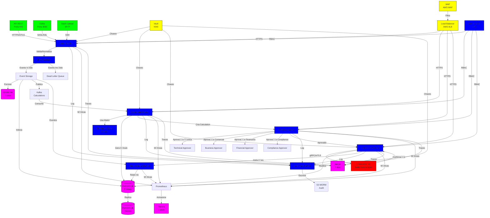

# Arquitetura de Referncia - Mulo Revenue Share

**Verso:** 1.0.0  
**Data:** 2024-11-02  
**Responsvel:** Arquitetura LOWDATAESC  
**Status:** Aprovado  

---

## 1. Introduo

### 1.1 Propsito
Este documento define a arquitetura de referncia do mulo Revenue Share, alinhada com a arquitetura existente do LOWDATAESC e projetada para processamento em escala internacional com alta disponibilidade, segurana e conformidade regulatria.

### 1.2 Escopo
A arquitetura abrange:
- Diagrama de componentes e dependncias
- Protocolos de comunicao
- Padres de integrao
- Escalabilidade e resilincia
- Segurana e observabilidade

---

## 2. Diagrama de Arquitetura

---

## 3. Componentes

### 3.1 Ingest Service
**Responsabilidade:** Receber, validar e normalizar eventos de receita.

**Funcionalidades:**
- Receber eventos via API REST, Kafka ou Batch
- Validar schema e assinatura digital
- Verificar idempotncia
- Normalizar para schema cannico
- Armazenar em S3 WORM e PostgreSQL
- Publicar em Kafka para processamento assncrono

**Tecnologias:**
- Linguagem: TypeScript (NestJS)
- Framework: NestJS
- Banco: PostgreSQL
- Mensageria: Kafka
- Armazenamento: S3

**Endpoints:**
- `POST /api/v1/revenue-events` (Ingesto)
- `GET /api/v1/revenue-events/{id}` (Consulta)
- `GET /api/v1/revenue-events` (Lista)

---

### 3.2 Event Validator
**Responsabilidade:** Validar eventos de receita.

**Funcionalidades:**
- Validar schema JSON Schema
- Verificar assinatura digital (ECDSA ou RSA)
- Verificar idempotncia (hash do payload)
- Validar campos obrigatrios
- Validar formatao (ISO 4217, ISO 3166-1, etc.)

**Tecnologias:**
- Linguagem: TypeScript
- Validao: ajv (JSON Schema validator)
- Criptografia: OpenSSL, WebCrypto

---

### 3.3 Calculation Service
**Responsabilidade:** Calcular distribuio de receita.

**Funcionalidades:**
- Agregar eventos por perodo
- Aplicar dedues (taxas, impostos, chargebacks, etc.)
- Calcular receita lquida
- Aplicar matriz de distribuio
- Calcular pisos e tetos
- Gerar calculation
- Calcular hash do clculo

**Tecnologias:**
- Linguagem: TypeScript (NestJS)
- Banco: PostgreSQL
- Cache: Redis

**Endpoints:**
- `POST /api/v1/calculations` (Criar)
- `GET /api/v1/calculations/{id}` (Consultar)
- `GET /api/v1/calculations` (Listar)

---

### 3.4 Distribution Matrix Service
**Responsabilidade:** Gerenciar matrizes de distribuio.

**Funcionalidades:**
- Criar, atualizar e versionar matrizes
- Validar matrizes (soma = 100%, etc.)
- Aprovar matrizes (workflow)
- Fornecer matriz ativa para perodo
- Avaliar DSL de elegibilidade

**Tecnologias:**
- Linguagem: TypeScript (NestJS)
- Banco: PostgreSQL

**Endpoints:**
- `GET /api/v1/distribution-matrices/{version}` (Consultar)
- `GET /api/v1/distribution-matrices` (Listar)

---

### 3.5 Workflow Service
**Responsabilidade:** Gerenciar workflow de aprovao.

**Funcionalidades:**
- Implementar mquina de estados
- Enforar segregao de funes (RBAC)
- Notificar aprovadores
- Escalar em caso de timeout
- Registrar trilha de auditoria

**Tecnologias:**
- Linguagem: TypeScript (NestJS)
- Workflow: Camunda (opcional) ou estado em banco
- Autenticao: OPA (Open Policy Agent)

**Endpoints:**
- `POST /api/v1/calculations/{id}/submit` (Submeter)
- `POST /api/v1/calculations/{id}/approve` (Aprovar)
- `POST /api/v1/calculations/{id}/reject` (Rejeitar)

---

### 3.6 Liquidao Service
**Responsabilidade:** Gerar e processar instrues de liquidao.

**Funcionalidades:**
- Gerar instrues de liquidao para cada participante
- Assinar digitalmente instrues
- Enviar para LOWDATAESC via gRPC
- Gerenciar retries com backoff exponencial
- Receber confirmaes do LOWDATAESC
- Atualizar status de clculos

**Tecnologias:**
- Linguagem: Go (para performance)
- Comunicao: gRPC
- Segurana: mTLS

**Endpoints:**
- `POST /api/v1/settlement-instructions` (Gerar)
- `GET /api/v1/settlement-instructions/{id}` (Consultar)

---

### 3.7 Reconciliation Service
**Responsabilidade:** Reconciliar eventos e liquidaes.

**Funcionalidades:**
- Agregar eventos e liquidaes por perodo
- Comparar totais
- Identificar divergncias
- Gerar relatrio de divergncias
- Notificar financeiro e compliance

**Tecnologias:**
- Linguagem: Python
- Banco: PostgreSQL
- Agendamento: Kubernetes CronJob

**Endpoints:**
- `POST /api/v1/reconciliations` (Executar)
- `GET /api/v1/reconciliations/{id}` (Consultar)

---

### 3.8 Audit Trail Service
**Responsabilidade:** Registrar trilha de auditoria imutvel.

**Funcionalidades:**
- Registrar todas as aes do sistema
- Gerar hash chain
- Armazenar em S3 WORM
- Verificar integridade
- Exportar proof bundles

**Tecnologias:**
- Linguagem: Rust (para performance e segurana)
- Armazenamento: S3 com Object Lock
- Hash: SHA-256

---

## 4. Dependncias Externas

### 4.1 LOWDATAESC
**Integrao:** gRPC com mTLS

**Servios Utilizados:**
- Settlement Adapter: Processamento de liquidaes
- Escrow Service: Gerenciamento de contas escrow
- Auth Service: Autenticao e autorizao

**Endpoints:**
- `settlement-adapter.lowdataesc.internal:50051` (gRPC)
- `escrow.lowdataesc.internal:50052` (gRPC)

---

### 4.2 Kafka
**Uso:** Mensageria para processamento assncrono

**Topics:**
- `revenue-events`: Eventos de receita (ingesto)
- `calculations`: Clculos (processamento)
- `settlement-instructions`: Instrues de liquidao
- `audit-logs`: Logs de auditoria

**Configurao:**
- Replicao: 3
- Partitions: 10 por topic
- Retention: 7 dias

---

### 4.3 PostgreSQL
**Uso:** Armazenamento de dados estruturados

**Bancos:**
- `revenue_share`: Dados do mulo
- `audit`: Trilha de auditoria (opcional, pode ser S3)

**Configurao:**
- Primary/Replica: Multi-AZ
- Backup: Contnuo (WAL archiving)
- Reteno: 7 anos

---

### 4.4 S3
**Uso:** Armazenamento imutvel

**Buckets:**
- `lowdataesc-revenue-events`: Eventos de receita (WORM)
- `lowdataesc-audit-logs`: Trilha de auditoria (WORM)
- `lowdataesc-proof-bundles`: Proof bundles (WORM)

**Configurao:**
- Object Lock: 7 anos
- Versioning: Habilitado
- Criptografia: SSE-KMS

---

### 4.5 Redis
**Uso:** Cache e sesses

**Casos de Uso:**
- Cache de matrizes de distribuio
- Cache de clculos recentes
- Rate limiting
- Sesses de usurios

**Configurao:**
- Cluster: 3 ns
- Persistncia: RDB + AOF
- TTL: Configurvel por chave

---

### 4.6 Vault
**Uso:** Gerenciamento de segredos e chaves

**Segredos Gerenciados:**
- Chaves de assinatura digital
- Certificados mTLS
- Credenciais de banco de dados
- Chaves de API externas

**Configurao:**
- Transit encryption: Habilitado
- Audit log: Habilitado
- Rotao de chaves: Automtica (90 dias)

---

## 5. Protocolos de Comunicao

### 5.1 API REST
**Protocolo:** HTTPS (TLS 1.3)
**Autenticao:** mTLS + JWT
**Autorizao:** RBAC via OPA
**Formato:** JSON
**Versionamento:** URL (v1, v2, etc.)

**Endpoints Pblicos:**
- `/api/v1/revenue-events`
- `/api/v1/calculations`
- `/api/v1/settlement-instructions`
- `/api/v1/disputes`

---

### 5.2 gRPC
**Protocolo:** gRPC com mTLS
**Formato:** Protocol Buffers
**Compresso:** gzip
**Streaming:** Suportado

**Servios:**
- `CalculationService`: Clculo de distribuio
- `SettlementService`: Liquidao
- `AuditService`: Trilha de auditoria

---

### 5.3 Kafka
**Protocolo:** SASL/SSL
**Formato:** Avro ou JSON Schema
**Compresso:** snappy
**QOS:** Exactly-once

**Topics:**
- `revenue-events`: Eventos de receita
- `calculations`: Clculos
- `settlement-instructions`: Instrues de liquidao

---

## 6. Segurana

### 6.1 Autenticao
- **mTLS:** Entre servios internos (SPIFFE/SPIRE)
- **JWT:** Para APIs externas
- **MFA:** Para usurios humanos (TOTP + Biometria)
- **Device Authentication:** Device fingerprint + certificado

### 6.2 Autorizao
- **RBAC:** Roles hierrquicos
- **ABAC:** Atributos (operao, valor, tipo)
- **OPA:** Open Policy Agent para polticas complexas
- **Segregao de Funes:** Matriz RACI

### 6.3 Criptografia
- **Em Trnsito:** TLS 1.3
- **Em Repouso:** AES-256 (KMS)
- **Chaves:** HSM ou KMS
- **Hash:** SHA-256

### 6.4 Proteo de Dados
- **LGPD:** Conformidade total
- **DLP:** Data Loss Prevention
- **Crypto-wipe:** Capacidade de apagar dados

---

## 7. Observabilidade

### 7.1 Logging
- **Ferramenta:** ELK Stack (Elasticsearch, Logstash, Kibana)
- **Formato:** JSON estruturado
- **Nveis:** DEBUG, INFO, WARN, ERROR
- **Reteno:** 7 dias (hot), 30 dias (warm), 1 ano (cold)

### 7.2 Mtricas
- **Ferramenta:** Prometheus + Thanos
- **Armazenamento:** 2 anos
- **Mtricas:**
  - Latncia (p50, p95, p99)
  - Throughput
  - Erros (rate, count)
  - Saturao (CPU, memria, disco, rede)

### 7.3 Tracing
- **Ferramenta:** OpenTelemetry + Jaeger
- **Sampling:** 100% para erros, 1% para sucesso
- **Armazenamento:** 7 dias
- **Correlao:** Trace ID propagado

### 7.4 Alertas
- **Ferramenta:** Alertmanager
- **Canais:** Slack, PagerDuty, Email
- **Nveis:** Crtico, Alto, Mdio, Baixo

---

## 8. Escalabilidade

### 8.1 Horizontal
- **Servios:** Todos os servios so stateless (exceto banco)
- **Kubernetes:** Deploy com HPA (Horizontal Pod Autoscaler)
- **Limite:** Mnimo 3 instncias por servio crtico

### 8.2 Vertical
- **Banco:** Read replicas + connection pooling
- **Cache:** Redis cluster
- **Mensageria:** Kafka com parties

### 8.3 Performance
- **Alvo:** 5000 TPS (ingesto de eventos)
- **Latncia:** < 100ms (p99)
- **Disponibilidade:** > 99.95%

---

## 9. Resilincia

### 9.1 RPO/RTO
- **RPO:** < 5 minutos
- **RTO:** < 15 minutos (servios), < 30 minutos (banco)

### 9.2 Backup e Restore
- **Banco:** WAL archiving + backup dirio
- **S3:** Versioning + cross-region replication
- **Teste:** Restore testado mensalmente

### 9.3 Multi-Region
- **Primary:** sa-east-1 (So Paulo)
- **Secondary:** us-east-1 (Virgnia) - standby
- **Failover:** Automtico com Route53

---

## 10. Implantao

### 10.1 Infraestrutura
- **Terraform:** IaC (Infrastructure as Code)
- **Kubernetes:** EKS (Elastic Kubernetes Service)
- **CI/CD:** GitHub Actions / GitLab CI
- **Imagens:** Docker imutveis

### 10.2 Ambientes
- **dev:** Desenvolvimento
- **staging:** Testes e homologao
- **production:** Produo

### 10.3 Deploy
- **Estratgia:** Blue-green ou Canary
- **Rollback:** Automtico em caso de falha
- **Sade:** Health checks + readiness probes

---

## 11. Critrios de Aceite

- [ ] Arquitetura documentada e validada
- [ ] Diagramas atualizados
- [ ] Componentes implementados conforme especificao
- [ ] Integrao com LOWDATAESC funcional
- [ ] Segurana implementada (mTLS, RBAC, etc.)
- [ ] Observabilidade completa (logging, mtricas, tracing)
- [ ] Escalabilidade validada (load tests)
- [ ] Resilincia testada (chaos engineering)

---

## 12. Anexos

- [Diagrama de Arquitetura Detalhado](ARCHITECTURE-DIAGRAM.md)
- [Especificao de APIs](OPENAPI-SPEC.md)
- [Especificao de Eventos](EVENT-SPEC.md)
- [Especificao de Integrao com LOWDATAESC](LOWDATAESC-INTEGRATION.md)

---

**Aprovado por:** _________________________  
**Data:** _______________  
**Verso:** 1.0.0
